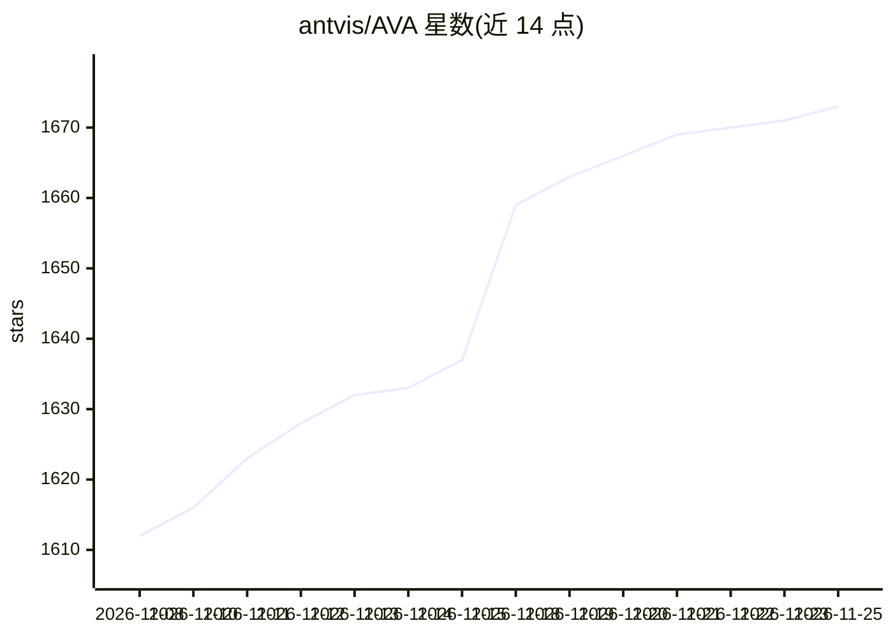

# antvis/AVA

⭐ 1,673 · TypeScript · MIT · 推送 2026-11-23 · [GitHub](https://github.com/antvis/AVA) · [官网](https://ava.antv.vision) · 组织维护

**面向 AI agent 的 JavaScript 可视化分析框架**

AVA 是一个视觉分析技术框架，A 代表 AI-native、Automated、Augmented，VA 代表 Visual Analytics。提供从数据接入、schema 检查、画像、语义定义、问题建议、分析到可视化的完整工作流，生成可核验的 SQL 与结果。支持文件与数据库混合查询，可在本地选择执行引擎与模型端点。以 npm 包发布，提供 Node.js 库、CLI 及 agent skill（npx skills add）三种使用方式；运行需 Node.js 22.13+，模型相关测试需自行配置模型设置。

## 筛选速览

| 维度 | 判定 | 备注 |
|---|---|---|
| AI 角色 | `ai-native` | 本体是模型或模型工具 |
| 许可风险 | `permissive` | MIT |
| 部署形态 | `library` | 以包/库形式分发 |
| 模型依赖 | — | README 未给出锁定关系 |
| 硬件要求 | — | 无带数字的原话,不猜 |
| 安装摩擦 | `low` | 无编译、无系统依赖或容器化 |
| 成熟度 | — | 结构信号不足 |

## 能力要点

- load→explore→suggest→analyze→visualize 的分析工作流，含 schema/profile/semantic 上下文
- 跨数据源分析：文件与数据库可在单一查询中 join
- 支持 CSV/JSON/Parquet/Excel、飞书多维表格、腾讯文档、GitHub 及多种数据库
- 提供 CLI 与 agent skill（npx skills add antvis/AVA）两种集成途径

## 适用场景

- 在应用中接入自然语言数据分析与图表生成
- 让 AI agent 调用数据工作流并获得可核验的 SQL 与结果
- 对本地或远程数据做探索性分析并可视化

## 场景标签

`数据分析` · 领域:效率与自动化

## 证据(README 行号)

> L25: AVA (AVA examples Visual Analytics) is a technology framework designed for more convenient visual analytics. **A** 
> L28:  AVA agent workflow: data access, schema inspection, profiling, metric definitions, analysis, visualization, and fo
> L32: > **Think of AVA as PandasAI for JavaScript. 💬📊🤖**

## 星数曲线

2026-11-08 1,612 → 2026-11-25 1,673（+61）

---
*卡片 v1 · prompt 1.4 · 生成 2026-11-24 · 置信度 mid · 依据 README sha `8bf2ed49e1c4` · [字段定义](../../DATASET.md)*
