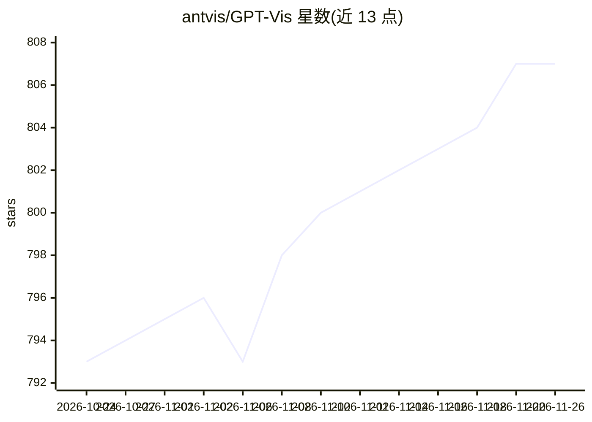

# antvis/GPT-Vis

⭐ 807 · TypeScript · MIT · 推送 2026-11-25 · [GitHub](https://github.com/antvis/GPT-Vis) · [官网](https://gpt-vis.antv.vision) · 组织维护 · 中文 README

**面向 LLM 应用的可视化渲染库：26 种图表随模型流式输出渲染**

AntV 出品的 AI 原生可视化库，支持以 JSON 对象或类 Markdown 的 DSL 语法渲染 18 种统计图表、6 种关系图和 2 种文本可视化，共 26 种图表类型。语法设计为 LLM 可直接生成，支持随模型流式输出边生成边渲染，并对不完整或畸形数据做容错处理。框架无关，提供原生 JS、React、Vue、Angular 及 Markdown 渲染器（marked）集成方式；主题支持内置切换与跨图表复用的 ThemeSpec。另提供 MCP Server 与 Chart Skill 供 AI 模型调用。

## 筛选速览

| 维度 | 判定 | 备注 |
|---|---|---|
| AI 角色 | `ai-ecosystem` | LLM/agent 周边工具 |
| 许可风险 | `permissive` | MIT |
| 部署形态 | `library` | 以包/库形式分发 |
| 模型依赖 | — | README 未给出锁定关系 |
| 硬件要求 | — | 无带数字的原话,不猜 |
| 安装摩擦 | `low` | 无编译、无系统依赖或容器化 |
| 成熟度 | — | 结构信号不足 |

## 能力要点

- 类 Markdown 的 DSL 语法，LLM 可直接生成
- 流式渲染：随 AI 模型输出边生成边绘制
- 26 种图表类型，含统计图、关系图与文本可视化
- 提供 MCP Server 与 Chart Skill 的 AI 集成方案

## 适用场景

- 在 LLM 对话应用中将模型输出实时渲染为图表
- 用 MCP Server 让 AI 模型直接调用可视化能力
- 在 Markdown 文档流中把 vis 代码块渲染成交互图表
- 为多图表应用统一复用品牌主题 ThemeSpec

## 场景标签

`数据分析` · 领域:效率与自动化

## 证据(README 行号)

> L5: AI-native visualization library for the LLM era. Framework-agnostic, ready to use.
> L362: - **MCP Server** — Enable AI models to directly invoke visualization capabilities via Model Context Protocol

## 星数曲线

2026-10-24 793 → 2026-11-26 807（+14）

---
*卡片 v1 · prompt 1.4 · 生成 2026-11-24 · 置信度 high · 依据 README sha `bc62d9258582` · [字段定义](../../DATASET.md)*
