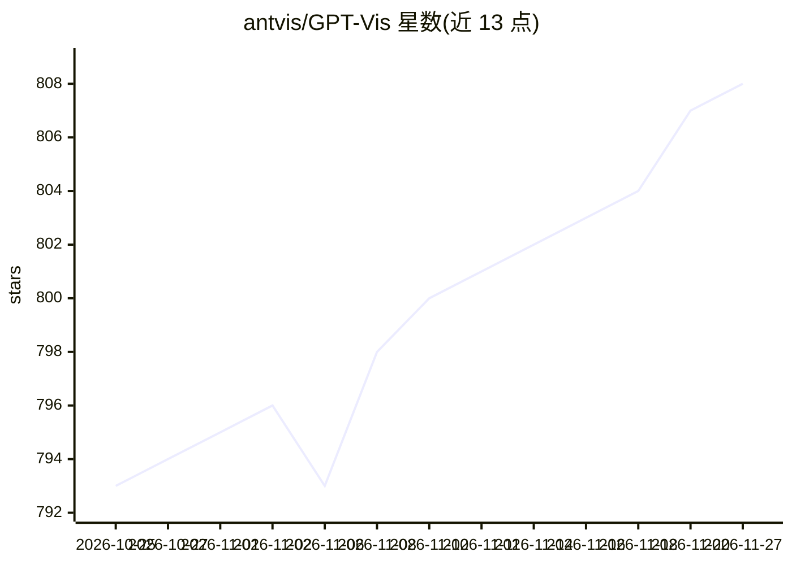

# antvis/GPT-Vis

⭐ 808 · TypeScript · MIT · 推送 2026-11-26 · [GitHub](https://github.com/antvis/GPT-Vis) · [官网](https://gpt-vis.antv.vision) · 组织维护 · 中文 README

**面向 AI 应用与 Agent 的图表可视化渲染库**

AntV 出品的开源可视化库，供 AI Agent 与应用将模型输出渲染为图表：接受 JSON 对象或类 Markdown 的 DSL 语法输入，支持流式部分输入渐进渲染，并对不完整或格式错误的内容做容错处理。内置 26 种图表类型（统计图、关系图、文本可视化）与 28 种分析标注能力，主题通过 ThemeSpec 跨图表复用。基于 G2、G6、T8 构建，可在原生 JavaScript、React、Vue 等浏览器框架中使用，另提供面向 AI 助手的 Agent Skill 与 MCP Server Chart 等集成入口。通过 npm 安装；需注意安装 Skill 不会升级渲染库版本。

## 筛选速览

| 维度 | 判定 | 备注 |
|---|---|---|
| AI 角色 | `ai-ecosystem` | LLM/agent 周边工具 |
| 许可风险 | `permissive` | MIT |
| 部署形态 | `library` | 以包/库形式分发 |
| 模型依赖 | — | README 未给出锁定关系 |
| 硬件要求 | — | 无带数字的原话,不猜 |
| 安装摩擦 | `low` | 无编译、无系统依赖或容器化 |
| 成熟度 | — | 结构信号不足 |

## 能力要点

- 26 种图表类型与 28 种分析标注（均值、目标线、排名、区间等，由 SDK 计算）
- 支持流式部分输入，模型生成过程中即渲染图表
- LLM 可直接生成的类 Markdown DSL 语法，含容错处理
- ThemeSpec 主题跨 26 种图表复用，提供 Theme Studio 与 AI 生成主题

## 适用场景

- 在 AI 聊天应用的回答中渲染流式图表
- 让 Agent 通过 Skill 生成带图表的数据报告
- 在 React/Vue 前端项目中将模型输出的数据可视化为统一品牌风格的图表

## 场景标签

 · 领域:数据可视化/AI 应用开发

## 证据(README 行号)

> L9: An open-source visualization library for AI agents and applications.
> L25: - ✍️ **Markdown-like Syntax** — Simple syntax that LLMs can generate directly, easy to learn and use
> L33: Built on G2, G6, and T8. Works with vanilla JavaScript, React, Vue, and other browser frameworks.

## 星数曲线

2026-10-25 793 → 2026-11-27 808（+15）

---
*卡片 v1 · prompt 1.4 · 生成 2026-11-27 · 置信度 high · 依据 README sha `6e52896de553` · [字段定义](../../DATASET.md)*
