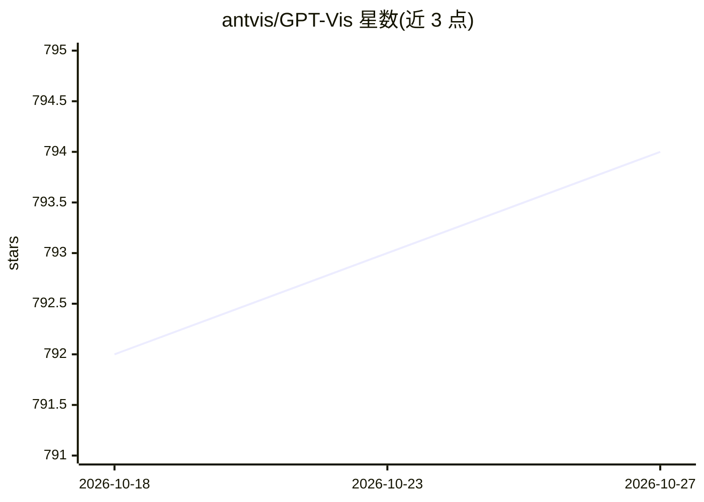

# antvis/GPT-Vis

⭐ 794 · TypeScript · MIT · 推送 2026-10-26 · [GitHub](https://github.com/antvis/GPT-Vis) · [官网](https://gpt-vis.antv.vision) · 组织维护 · 中文 README

**面向 LLM 场景的可视化库：渲染 LLM 生成的图表语法**

AntV 的 GPT-Vis 是面向 LLM 时代的可视化库，框架无关，支持原生 JS、React、Vue 等。提供两种输入：JSON 对象配置与类 Markdown 的 DSL 语法，后者可由 LLM 直接生成；支持流式渲染，模型边生成边出图，并对不完整/畸形数据做容错处理。内置 26 种图表类型（统计图、关系图、文本可视化）与三种主题。另提供 MCP Server 与 Chart Skill，使 AI 模型可调用可视化能力；支持通过 shadcn CLI 复制 React 组件源码。以 npm 包形式分发，MIT 许可。

## 筛选速览

| 维度 | 判定 | 备注 |
|---|---|---|
| AI 角色 | `ai-ecosystem` | LLM/agent 周边工具 |
| 许可风险 | `permissive` | MIT |
| 部署形态 | `library` | 以包/库形式分发 |
| 模型依赖 | — | README 未给出锁定关系 |
| 硬件要求 | — | 无带数字的原话,不猜 |
| 安装摩擦 | `low` | 无编译、无系统依赖或容器化 |
| 成熟度 | — | 结构信号不足 |

## 能力要点

- 类 Markdown 的 DSL 语法，LLM 可直接生成
- 流式渲染：模型输出过程中实时出图
- 26 种图表类型（18 统计 + 6 关系 + 2 文本）
- 提供 MCP Server 与 Chart Skill 供 AI 模型调用

## 适用场景

- 为 LLM 应用或聊天界面渲染 AI 生成的图表
- 通过 MCP 让 AI 模型直接调用可视化能力
- 在 React/Vue/原生 JS 项目中集成 AI 友好的图表组件

## 场景标签

`数据分析` · 领域:效率与自动化

## 证据(README 行号)

> L5: AI-native visualization library for the LLM era. Framework-agnostic, ready to use.
> L322: - **MCP Server** — Enable AI models to directly invoke visualization capabilities via Model Context Protocol

## 星数曲线

2026-10-18 792 → 2026-10-27 794（+2）

---
*卡片 v1 · prompt 1.4 · 生成 2026-10-22 · 置信度 high · 依据 README sha `d729fe5e3fd6` · [字段定义](../../DATASET.md)*
