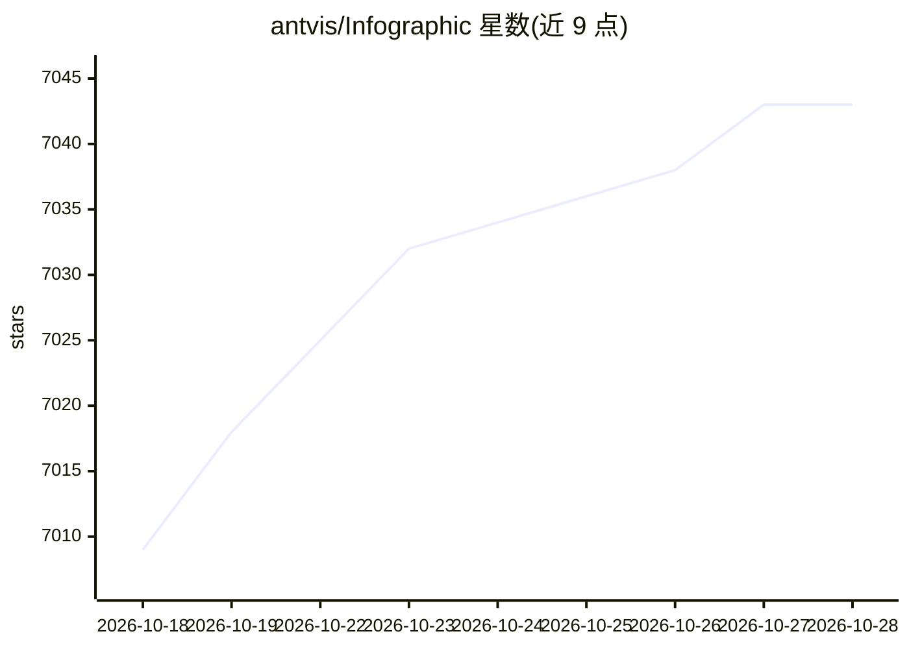

# antvis/Infographic

⭐ 7,043 · TypeScript · MIT · 推送 2026-10-20 · [GitHub](https://github.com/antvis/Infographic) · [官网](https://infographic.antv.vision) · 组织维护 · 中文 README

**面向 AI 生成的声明式信息图渲染引擎，含 200 模板**

AntV 团队的声明式信息图可视化引擎：提供专为 AI 生成调优的信息图语法，支持 AI 流式输出边生成边渲染，内置约 200 个模板、数据组件与布局，带主题系统与内置编辑器，默认输出高质量 SVG。提供技能包（infographic-creator 等）接入 Claude Code、Codex 等 AI agent，生态中列出多个基于它的产品与库。以 npm 包 @antv/infographic 形式安装，MIT 许可。

## 筛选速览

| 维度 | 判定 | 备注 |
|---|---|---|
| AI 角色 | `ai-ecosystem` | LLM/agent 周边工具 |
| 许可风险 | `permissive` | MIT |
| 部署形态 | `library` | 以包/库形式分发 |
| 模型依赖 | — | README 未给出锁定关系 |
| 硬件要求 | — | 无带数字的原话,不猜 |
| 安装摩擦 | `low` | 无编译、无系统依赖或容器化 |
| 成熟度 | — | 结构信号不足 |

## 能力要点

- 语法专为 AI 生成调优，支持流式输出渐进渲染
- ~200 个内置模板、数据项组件与布局
- 内置信息图编辑器，可继续编辑 AI 生成结果
- 提供技能包接入 Claude Code / Codex 等 AI agent

## 适用场景

- 为 AI agent 提供信息图生成与渲染能力
- 从文字描述快速生成可编辑的信息图
- 在 Web 应用中流式渲染 AI 产出的信息图语法

## 场景标签

 · 领域:可视化/AI 生成

## 证据(README 行号)

> L5: 🦋 An Infographic Generation and Rendering Framework, bring words to life!
> L14: **AntV Infographic** is AntV's next-generation **declarative infographic visualization engine**. With a carefully d
> L39: - 🤖 **AI-friendly**: Configuration and syntax are tuned for AI generation, provide concise prompts, and support AI 

## 星数曲线

2026-10-18 7,009 → 2026-10-28 7,043（+34）

---
*卡片 v1 · prompt 1.4 · 生成 2026-10-20 · 置信度 high · 依据 README sha `5703100eb87e` · [字段定义](../../DATASET.md)*
