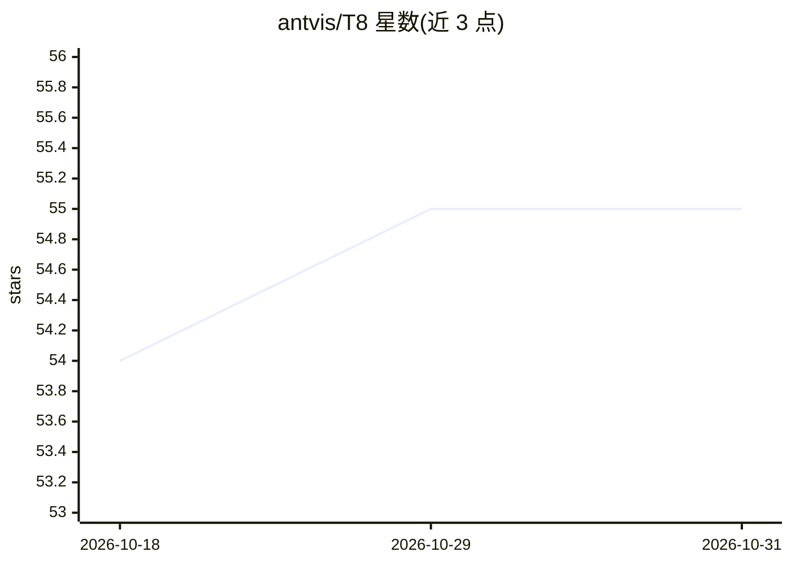

# antvis/T8

⭐ 55 · TypeScript · MIT · 推送 2026-09-04 · [GitHub](https://github.com/antvis/T8) · [官网](https://t8.antv.vision/en/examples.html) · 组织维护 · 中文 README

**AntV 生态的非结构化数据叙事文本可视化渲染库**

AntV 技术栈下的文本可视化解决方案：定义一套声明式 markdown 语法（T8 syntax）描述数据解读报告内容，由服务端（或 AI）生成语法，前端负责消费并渲染。技术栈无关，可用于 React、Vue 等前端框架；支持注册自定义 EntityPhrase 扩展 UI 元素，gzip 前体积小于 20 Kb。其语法设计为 LLM 友好，可通过 prompt 让 AI 模型生成 T8 语法，并提供 Prompt 模板与 LLM 集成指南。以 npm 包 @antv/t8 形式提供。

## 筛选速览

| 维度 | 判定 | 备注 |
|---|---|---|
| AI 角色 | `ai-enhanced` | 去掉 AI 部分产品仍成立 |
| 许可风险 | `permissive` | MIT |
| 部署形态 | `library` | 以包/库形式分发 |
| 模型依赖 | — | README 未给出锁定关系 |
| 硬件要求 | — | 无带数字的原话,不猜 |
| 安装摩擦 | `low` | 无编译、无系统依赖或容器化 |
| 成熟度 | — | 结构信号不足 |

## 能力要点

- 声明式 markdown 语法描述数据解读报告并统一渲染
- 技术栈无关，可用于 React、Vue 等前端框架
- 语法 LLM 友好，提供 prompt 模板与 LLM 集成指南
- 注册自定义 EntityPhrase 扩展 UI 元素，gzip 前小于 20 Kb

## 适用场景

- 在前端渲染 AI 或服务端生成的数据解读报告文本
- 构建自动化数据叙事生成与展示流程
- 在 AntV 技术栈中统一文本模板的渲染方式

## 场景标签

 · 领域:可视化/前端组件

## 证据(README 行号)

> L5: `T8` is a text visualization solution for unstructured data within the AntV technology stack, where `T` stands for T
> L27: - 🤖 **LLM friendly** - The T8's `syntax` is easy to be generated by `AI` with prompt.

## 星数曲线

2026-10-18 54 → 2026-10-31 55（+1）

---
*卡片 v1 · prompt 1.4 · 生成 2026-10-24 · 置信度 high · 依据 README sha `f95a83809ee9` · [字段定义](../../DATASET.md)*
