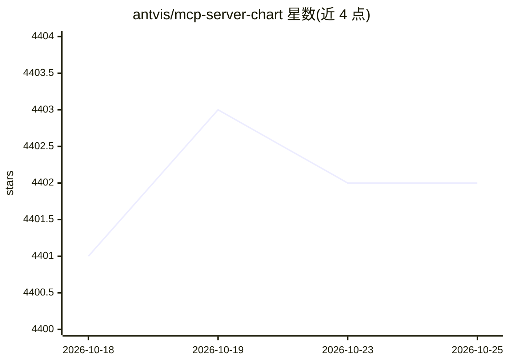

# antvis/mcp-server-chart

⭐ 4,403 · TypeScript · MIT · 推送 2026-08-27 · [GitHub](https://github.com/antvis/mcp-server-chart) · [官网](https://github.com/antvis/mcp-server-chart) · 组织维护 · 中文 README

**给 LLM/MCP 客户端的图表生成服务器：26+ 种可视化**

AntV 团队维护的 TypeScript MCP 服务器，通过 MCP 工具提供 26+ 种图表生成能力（柱状图、饼图、桑基图、思维导图、行政区划地图等），供 Claude、VSCode、Cursor、Cline、Cherry Studio 等桌面 AI 客户端及 Dify 平台使用。默认调用 AntV 免费图表渲染服务，也支持通过 VIS_REQUEST_SERVER 指向 GPT-Vis-SSR 私有部署服务；地理图表依赖高德地图且仅支持中国境内，私有部署不支持 3 个地理工具。另提供 chart-visualization 技能供 Claude Code 等 AI IDE 自动选型出图。

## 筛选速览

| 维度 | 判定 | 备注 |
|---|---|---|
| AI 角色 | `ai-ecosystem` | LLM/agent 周边工具 |
| 许可风险 | `permissive` | MIT |
| 部署形态 | `self-host` | docker 或自建部署 |
| 模型依赖 | — | README 未给出锁定关系 |
| 硬件要求 | — | 无带数字的原话,不猜 |
| 安装摩擦 | `low` | 无编译、无系统依赖或容器化 |
| 成熟度 | — | 结构信号不足 |

## 能力要点

- 26+ 种图表 MCP 工具（含思维导图、流程图、地图、透视表）
- 支持 SSE 与 Streamable 传输，可 HTTP 部署到 aliyun/modelscope 等
- VIS_REQUEST_SERVER 支持 GPT-Vis-SSR 私有化部署
- DISABLED_TOOLS 环境变量可禁用指定工具

## 适用场景

- 在 Claude/Cursor 等 AI 客户端中直接生成数据可视化图表
- 数据分析对话中自动产出图表结果
- 企业内通过私有部署服务生成图表

## 场景标签

`数据分析` · 领域:效率与自动化

## 证据(README 行号)

> L3: A Model Context Protocol server for generating charts using AntV. We can use this mcp server for _chart generation_ 
> L9: This is a TypeScript-based MCP server that provides chart generation capabilities. It allows you to create various t

## 星数曲线

2026-10-18 4,401 → 2026-10-25 4,402（+1）

---
*卡片 v1 · prompt 1.4 · 生成 2026-10-20 · 置信度 high · 依据 README sha `e91ed7857164` · [字段定义](../../DATASET.md)*
