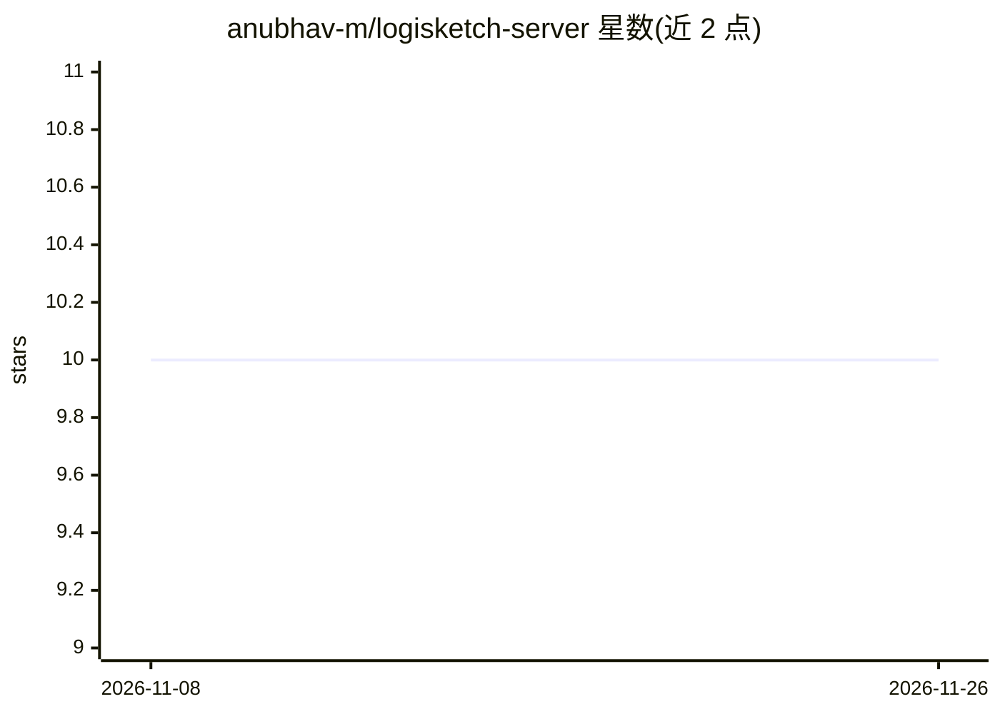

# anubhav-m/logisketch-server

⭐ 10 · JavaScript · MIT · 推送 2026-11-05 · [GitHub](https://github.com/anubhav-m/logisketch-server) · [官网](https://logisketch.onrender.com) · 个人维护

**后端图表生成服务：自然语言/图片转 15 种引擎的技术图**

Node/Express 后端服务，接收自然语言（可选附图）生成系统架构、ER、流程图、时序图、网络包图、电路与数学图等。LLM（Gemini，通过 GEMINI_MODEL 配置）生成图表代码，Kroki 负责渲染 SVG；每个引擎配有本地维护的语法笔记，经 RAG（本地 TF-IDF 嵌入，无向量数据库）注入提示词，可开关并带降级回退。附 JWT 认证、API key、MongoDB 交互存储、Arcjet 限流，以及 30 条 prompt 的 RAG 开/关对比评测命令与报告。需自备 Gemini API key；测试集仅覆盖 15 引擎中的 10 个。

## 筛选速览

| 维度 | 判定 | 备注 |
|---|---|---|
| AI 角色 | `ai-native` | 本体是模型或模型工具 |
| 许可风险 | `permissive` | MIT |
| 部署形态 | `library` | 以包/库形式分发 |
| 模型依赖 | — | README 未给出锁定关系 |
| 硬件要求 | — | 无带数字的原话,不猜 |
| 安装摩擦 | `low` | 无编译、无系统依赖或容器化 |
| 成熟度 | — | 结构信号不足 |

## 能力要点

- 15 种 Kroki 图表引擎（PlantUML/Mermaid/Graphviz/D2/C4 等）
- 引擎专属 RAG：本地哈希 TF-IDF 嵌入，无向量数据库与额外配额
- LLM 客户端含超时、指数退避重试、多 key 轮换与请求节流
- 可复现评测：30 prompt、RAG off/on 对比、JSON+Markdown 报告

## 适用场景

- 从文字描述生成架构图、ER 图、时序图并拿到 SVG
- 上传截图让服务重建对应的关系图
- 通过 API 集成图表生成能力到自己的工具链

## 场景标签

`代码生成` `RAG` `模型评测` · 领域:编码与开发

## 证据(README 行号)

> L7: A backend-only diagram assistant: the LLM writes diagram code, Kroki renders it.
> L38: - Natural language (and image) to diagram via Kroki

## 星数曲线

2026-11-08 10 → 2026-11-26 10（+0）

---
*卡片 v1 · prompt 1.4 · 生成 2026-11-20 · 置信度 high · 依据 README sha `605c97338920` · [字段定义](../../DATASET.md)*
