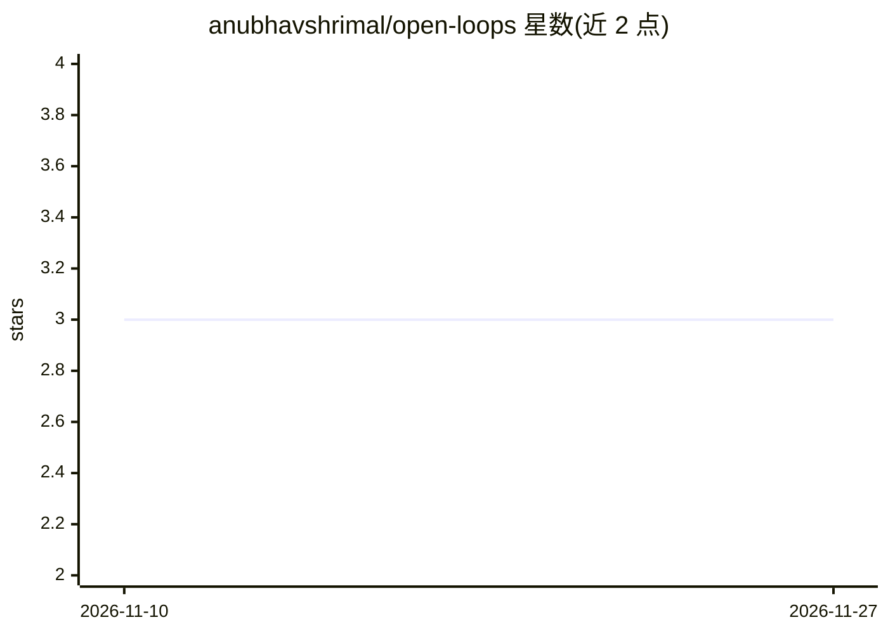

# anubhavshrimal/open-loops

⭐ 3 · Python · MIT · 推送 2026-11-25 · [GitHub](https://github.com/anubhavshrimal/open-loops) · [官网](https://anubhavshrimal.github.io/open-loops/) · 个人维护

**开发者用任务编排器：规格进、已审 PR 出，驱动编码代理工作**

Open Loops 从 Tracker 取 Task，将每个 Ready 状态的 Task 交给一个编码代理 Worker，在独立 git worktree 中运行闭环（构建、测试、审查、修复），完成后开 PR 并等待人工 Review；可信作者的评论会让 Worker 在同一 worktree 重生。核心由 orchestrator.md、worker-rules.md 与 state.json 构成，Host/Runtime/Tracker/Review/Notifier 五个 Slot 均可替换为用户自己的工具（GitHub Issues/gh、tmux、Markdown 文件夹、本地分支等）。仅 v0.2 预览版，代理无人值守运行，README 专门给出安全注意事项。

## 筛选速览

| 维度 | 判定 | 备注 |
|---|---|---|
| AI 角色 | `ai-ecosystem` | LLM/agent 周边工具 |
| 许可风险 | `permissive` | MIT |
| 部署形态 | `None` |  |
| 模型依赖 | — | README 未给出锁定关系 |
| 硬件要求 | — | 无带数字的原话,不猜 |
| 安装摩擦 | `low` | 无编译、无系统依赖或容器化 |
| 成熟度 | `idea` | |

## 能力要点

- 每 Task 一个 git worktree 与 ol- 分支，与用户自己的 checkout 隔离
- 五 Slot（Host/Runtime/Tracker/Review/Notifier）按 Contract 可替换为本地回退方案
- 代理只开 PR 不合并；仅受信任作者的评论可驱动 Worker
- 安装方式是让编码代理按 SETUP.md 自动完成设置

## 适用场景

- 用 Claude Code 或 Codex 等代理按 Spec 批量产出待审 PR
- 夜间让 Exploration Worker 试探多种方案并生成结果报告
- 无 GitHub 账号时用本地 Markdown 文件夹与本地分支跑完整循环

## 场景标签

`编码 Agent` `Agent 框架` · 领域:Agent 开发

## 证据(README 行号)

> L13: Open Loops takes Tasks from your Tracker and gives each one to a coding-agent Worker in its own git worktree. The W
> L55: 2. **A Cycle starts on a schedule.** The Host (Claude Code, Codex, KiroCrew or OpenClaw) starts the Orchestrator as
> L72:  The core and its five Slots. The core is the same for every Owner: orchestrator.md (one Cycle: watches Workers, sp

## 星数曲线

2026-11-10 3 → 2026-11-27 3（+0）

---
*卡片 v1 · prompt 1.4 · 生成 2026-11-22 · 置信度 high · 依据 README sha `477769357594` · [字段定义](../../DATASET.md)*
