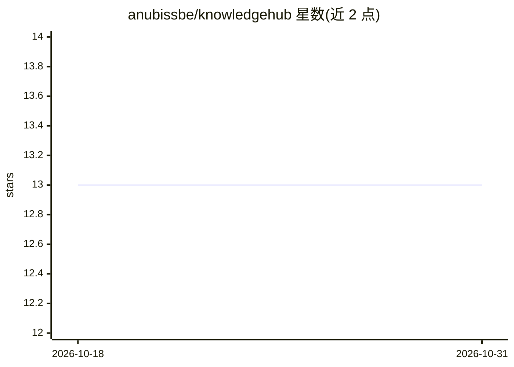

# anubissbe/knowledgehub

⭐ 13 · Python · 推送 2026-02-24 · [GitHub](https://github.com/anubissbe/knowledgehub) · 个人维护

**给 AI 编码工具提供持久记忆与上下文的开发平台**

面向开发者的 AI 增强开发平台：为 Claude Code、GitHub Copilot、Cursor 等编码工具提供持久记忆、跨会话上下文与智能上下文注入，支持向量检索与 RAG 系统、多项目隔离、实时分析。本地优先运行，数据保留在自有基础设施。声明自身不生成代码、非编辑器，通过 Docker Compose 部署，提供 REST API 与 Web UI，需 Docker 与 4GB+ 内存。

## 筛选速览

| 维度 | 判定 | 备注 |
|---|---|---|
| AI 角色 | `ai-ecosystem` | LLM/agent 周边工具 |
| 许可风险 | `none` | — |
| 部署形态 | `self-host` | docker 或自建部署 |
| 模型依赖 | — | README 未给出锁定关系 |
| 硬件要求 | — | 无带数字的原话,不猜 |
| 安装摩擦 | `low` | 无编译、无系统依赖或容器化 |
| 成熟度 | — | 结构信号不足 |

## 能力要点

- 跨工具与跨会话的持久记忆与上下文维护
- 与 Claude Code、GitHub Copilot、Cursor 等任意 AI 工具集成
- 向量检索与 RAG 系统，覆盖代码与文档
- 本地优先运行，多项目隔离与团队协作

## 适用场景

- 让 AI 编码助手记住项目决策与历史上下文
- 团队在多项目中隔离管理与共享知识库
- 为现有编码工具接入统一的记忆与检索后端

## 场景标签

`Agent 记忆` `RAG` · 领域:Agent 开发

## 证据(README 行号)

> L58: - **Universal AI Backend**: Works with any AI coding assistant
> L66: - **Not an AI Model**: Doesn't generate code itself

## 星数曲线

2026-10-18 13 → 2026-10-31 13（+0）

---
*卡片 v1 · prompt 1.4 · 生成 2026-10-31 · 置信度 high · 依据 README sha `fe87fa0326cf` · [字段定义](../../DATASET.md)*
