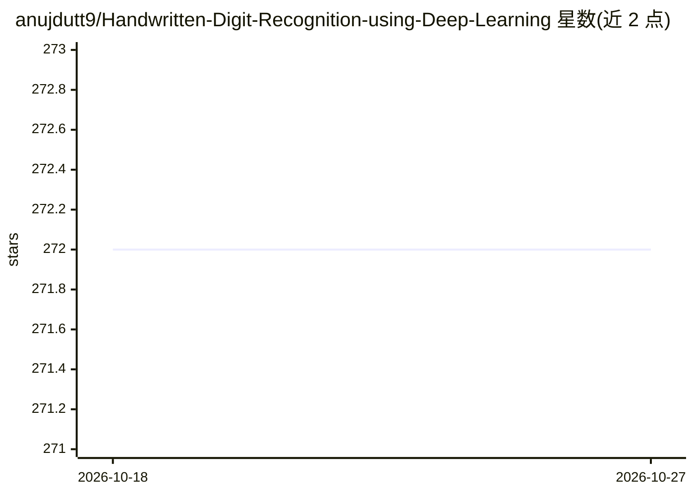

# anujdutt9/Handwritten-Digit-Recognition-using-Deep-Learning

⭐ 272 · Python · MIT · 推送 2026-04-14 · [GitHub](https://github.com/anujdutt9/Handwritten-Digit-Recognition-using-Deep-Learning) · 个人维护

**MNIST 手写数字识别：多种 ML 与 CNN 算法的对比实现**

在 MNIST 数据集上实现手写数字识别的 Python 代码集合，包含 KNN、SVM、随机森林三种机器学习算法与基于 TensorFlow/Keras 的三层 CNN。经典 ML 路径需手动下载并放置 MNIST 四个数据文件，CNN 路径自动下载数据，支持保存/加载模型权重（hdf5），输出日志写入 summary.log。README 列出各算法准确率：KNN 96.67%、SVM 97.91%、随机森林 96.82%、CNN（TensorFlow）99.70%。代码在 Python 3.5 下编写，曾在 AWS EC2 上执行。

## 筛选速览

| 维度 | 判定 | 备注 |
|---|---|---|
| AI 角色 | `ai-native` | 本体是模型或模型工具 |
| 许可风险 | `permissive` | MIT |
| 部署形态 | `None` |  |
| 模型依赖 | — | README 未给出锁定关系 |
| 硬件要求 | — | 无带数字的原话,不猜 |
| 安装摩擦 | `low` | 无编译、无系统依赖或容器化 |
| 成熟度 | — | 结构信号不足 |

## 能力要点

- KNN/SVM/随机森林与 TensorFlow、Keras+Theano 两种 CNN 共五种实现
- CNN 支持 --save_model/--load_model 保存与加载 hdf5 权重
- CNN 路径自动下载 MNIST 数据，ML 路径手动放置
- 关联已发表论文 IJARCET-VOL-6-ISSUE-7-990-997

## 适用场景

- 对比经典机器学习与 CNN 在 MNIST 上的识别效果
- 学习手写数字识别的多种算法实现
- 复现论文中的实验结果

## 场景标签

`目标检测` · 领域:感知与多模态

## 证据(README 行号)

> L1: # Handwritten Digit Recognition using Machine Learning and Deep Learning
> L118: i)	Three Layer Convolutional Neural Network using Tensorflow:	99.70%

## 星数曲线

2026-10-18 272 → 2026-10-27 272（+0）

---
*卡片 v1 · prompt 1.4 · 生成 2026-10-22 · 置信度 high · 依据 README sha `a09adb12528b` · [字段定义](../../DATASET.md)*
