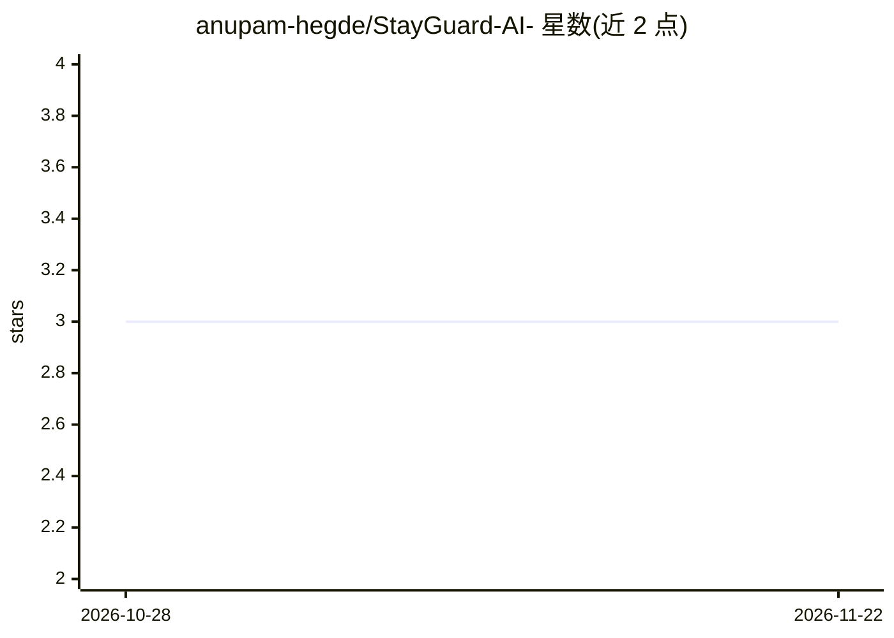

# anupam-hegde/StayGuard-AI-

⭐ — · [GitHub]() · 个人维护

**面向酒店的预订取消概率预测与 MLOps 流水线**

一个端到端 MLOps 项目，用 LightGBM 模型预测酒店预订取消概率并输出 Low/Medium/High 风险分级。数据经 Pandera schema 校验，特征变换与估计器封装为单一 Scikit-Learn Pipeline 序列化；训练参数与指标由 MLflow 跟踪；推理层为 FastAPI/Uvicorn 服务，提供单条与批量预测及健康探针端点；通过 Jenkins 与 Docker 在 GCP 上做 CI/CD。含 pytest 测试套件与 Web 仪表盘。

## 筛选速览

| 维度 | 判定 | 备注 |
|---|---|---|
| AI 角色 | `ai-native` | 本体是模型或模型工具 |
| 许可风险 | `viral` | — |
| 部署形态 | `self-host` | docker 或自建部署 |
| 模型依赖 | — | README 未给出锁定关系 |
| 硬件要求 | — | 无带数字的原话,不猜 |
| 安装摩擦 | `low` | 无编译、无系统依赖或容器化 |
| 成熟度 | — | 结构信号不足 |

## 能力要点

- LightGBM 模型输出取消概率与三级风险分层
- Pandera schema 校验与统一 Pipeline 保证训练/服务一致
- FastAPI 提供单条/批量/健康检查 REST 端点
- MLflow 实验跟踪与 Jenkins+Docker CI/CD

## 适用场景

- 酒店对高风险预订自动要求押金或触发挽留策略
- 基于预期取消量做超售缓冲与收益管理
- 学习 MLOps 全流程（校验/跟踪/服务/CI-CD）的参考实现

## 场景标签

`MLOps` · 领域:训练与推理

## 证据(README 行号)

> L82: **StayGuard AI** is a production-hardened predictive intelligence system that continuously monitors incoming hotel 
> L15: **Production-grade MLOps platform delivering real-time hotel reservation cancellation intelligence, robust schema v

## 星数曲线

2026-10-28 3 → 2026-11-22 3（+0）

---
*卡片 v1 · prompt 1.4 · 生成 2026-11-22 · 置信度 high · 依据 README sha `2ca6b66e9c88` · [字段定义](../../DATASET.md)*
