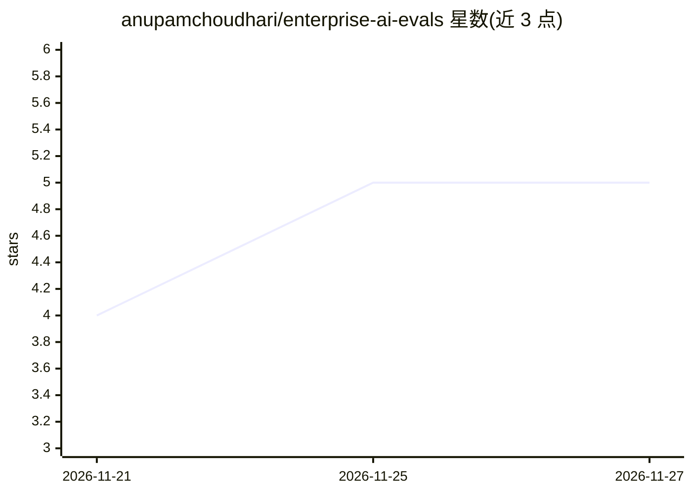

# anupamchoudhari/enterprise-ai-evals

⭐ 5 · Python · MIT · 推送 2026-11-17 · [GitHub](https://github.com/anupamchoudhari/enterprise-ai-evals) · 个人维护

**给产品经理写企业级 AI 评测的 PRD 模板与方法**

面向在企业 SaaS 中交付 AI 功能的产品经理的操作手册：提供 Eval PRD 模板、按风险等级（Low/Medium/High）设定的默认通过标准（测试用例数、质量分数、重复运行通过率），以及逐轮对话检查点、禁用文档与植入标记串等企业失败模式用例。附机器可读的 eval-prd.yaml 与评分脚本，脚本可退出报错以在 CI 中阻断发布；另含 RAG、NL2SQL 等 10 个用例包与起草提示词。代码 MIT，文档 CC BY 4.0。

## 筛选速览

| 维度 | 判定 | 备注 |
|---|---|---|
| AI 角色 | `ai-knowledge` | 知识聚合/清单类 |
| 许可风险 | `permissive` | MIT |
| 部署形态 | `library` | 以包/库形式分发 |
| 模型依赖 | — | README 未给出锁定关系 |
| 硬件要求 | — | 无带数字的原话,不猜 |
| 安装摩擦 | `low` | 无编译、无系统依赖或容器化 |
| 成熟度 | — | 结构信号不足 |

## 能力要点

- Eval PRD 模板按 5 天节奏组织，末尾映射工程师需构建的测试与监控
- 按 stakes 分级给出测试用例数、质量分、重复运行通过率等默认标准
- 逐轮对话检查与多次重复运行捕获第三轮泄漏等对话级失败
- 机器可读 eval-prd.yaml 与评分脚本可接入 CI 阻断发布

## 适用场景

- 为企业 SaaS 中的 AI 功能在一周内写出评测文档
- 在 CI 中设置阻断不良发布的对话级检查
- 为 RAG、NL2SQL、客服机器人等场景挑选失败模式与测试用例

## 场景标签

`模型评测` `教程课程` · 领域:评测与运维

## 证据(README 行号)

> L1: # Enterprise AI Evals: write your evals as a PRD
> L3: A playbook for product managers who ship AI features in enterprise SaaS products and knowledge layers. You write one
> L36: You need one template: the **Eval PRD**. Read the filled-in Planwise example first.

## 星数曲线

2026-11-21 4 → 2026-11-27 5（+1）

---
*卡片 v1 · prompt 1.4 · 生成 2026-11-21 · 置信度 high · 依据 README sha `8659533b4c23` · [字段定义](../../DATASET.md)*
