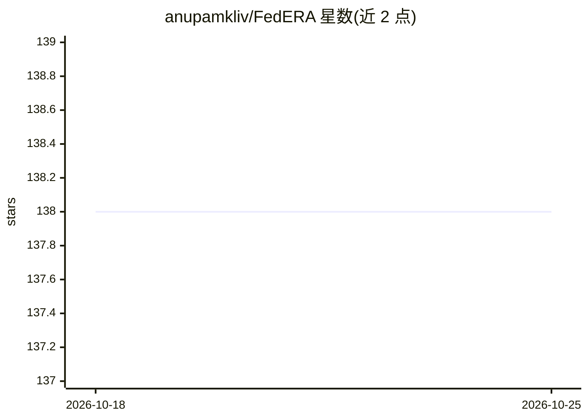

# anupamkliv/FedERA

⭐ 138 · Jupyter Notebook · Apache-2.0 · 推送 2026-02-02 · [GitHub](https://github.com/anupamkliv/FedERA) · [官网](https://federa.readthedocs.io) · 组织维护

**面向边缘设备的联邦学习框架：支持异构设备训练与碳排放追踪**

模块化联邦学习框架，支持服务器与客户端在单机或分离设备上运行，涵盖 Intel CPU、Nvidia GPU/Jetson、Raspberry Pi、Intel NUC 等异构边缘设备。实现 FedAvg、FedDyn、SCAFFOLD、FedAdam 等 9 种联邦学习算法，内置验证模块、超时模块、中间客户端接入模块与基于 CodeCarbon 的碳排放追踪模块。支持 MNIST/CIFAR 系列及自定义数据集的非 IID 划分，模型从 torchvision.models 加载。提供 pip、源码与 Docker 三种安装方式。

## 筛选速览

| 维度 | 判定 | 备注 |
|---|---|---|
| AI 角色 | `ai-ecosystem` | LLM/agent 周边工具 |
| 许可风险 | `permissive` | Apache-2.0 |
| 部署形态 | `self-host` | docker 或自建部署 |
| 模型依赖 | — | README 未给出锁定关系 |
| 硬件要求 | — | 无带数字的原话,不猜 |
| 安装摩擦 | `low` | 无编译、无系统依赖或容器化 |
| 成熟度 | — | 结构信号不足 |

## 能力要点

- 9 种联邦学习算法（FedAvg/FedDyn/SCAFFOLD/FedAdam 等）
- 验证、超时、中间客户端接入、碳排放追踪 4 个可组合模块
- 多种 Non-IID 数据划分方案与自定义数据集/模型支持
- 服务器与客户端可跨异构设备分离部署

## 适用场景

- 在边缘设备集群上开展联邦学习实验
- 研究不同 Non-IID 分布下各算法的精度表现
- 追踪联邦训练过程中客户端的碳排放

## 场景标签

`模型训练` · 领域:训练与推理

## 证据(README 行号)

> L15: `FedERA` is a highly dynamic and customizable framework that can accommodate many use cases with flexibility by imp
> L130: ## The framework is be composed of 4 modules, each module building upon the last:
> L148: ## Federated Learning Algorithms

## 星数曲线

2026-10-18 138 → 2026-10-25 138（+0）

---
*卡片 v1 · prompt 1.4 · 生成 2026-10-22 · 置信度 high · 依据 README sha `d0f39f88d6ad` · [字段定义](../../DATASET.md)*
