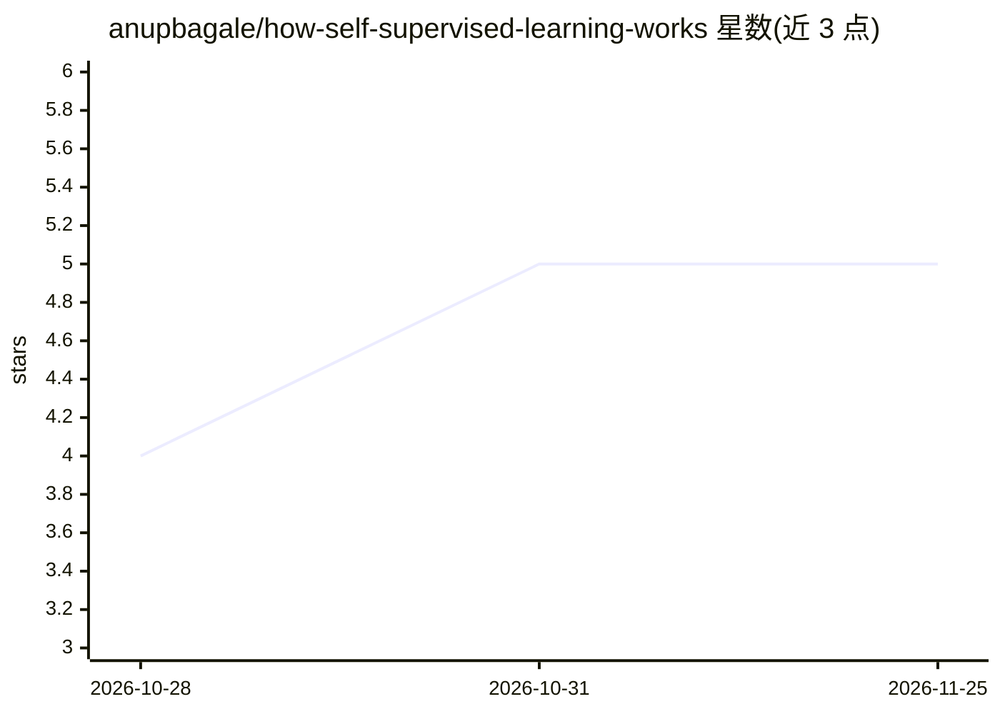

# anupbagale/how-self-supervised-learning-works

⭐ 5 · Python · MIT · 推送 2026-10-11 · [GitHub](https://github.com/anupbagale/how-self-supervised-learning-works) · 个人维护

**教程：用掩码自编码器无标注检测脑部病灶**

系列教程第 3 部分，围绕同一个合成脑部切片演示自监督学习：在 2 万张无标注切片上训练 MAE（隐藏 75% 图像块再重建），利用重建误差定位病灶，400 张测试扫描上零标注 AUROC 0.994；另比较 4 种少样本标注方案（16–1024 张标注）的准确率。README 声明数据为合成幻影、异常检测仅针对亮于预期的病灶等限制，并给出 git clone 与 pip 安装步骤、仓库结构与参考文献。

## 筛选速览

| 维度 | 判定 | 备注 |
|---|---|---|
| AI 角色 | `ai-knowledge` | 知识聚合/清单类 |
| 许可风险 | `permissive` | MIT |
| 部署形态 | `library` | 以包/库形式分发 |
| 模型依赖 | — | README 未给出锁定关系 |
| 硬件要求 | — | 无带数字的原话,不猜 |
| 安装摩擦 | `low` | 无编译、无系统依赖或容器化 |
| 成熟度 | — | 结构信号不足 |

## 能力要点

- MAE 训练与异常评分的完整可复现代码（selfsup/mae.py、anomaly.py）
- 40 个 epoch 约 13 分钟可在笔记本 CPU 上完成
- 零标注病灶检测 AUROC 0.994（400 张测试扫描）
- 16–1024 标注量下 4 种方案的准确率对比数据

## 适用场景

- 学习掩码自编码器的原理与实现细节
- 了解自监督预训练在少标注医学影像中的应用方式
- 按 README 步骤在本机复现训练与检测流程

## 场景标签

`教程课程` · 领域:学习与行业

## 证据(README 行号)

> L17: This is part 3 of a series that follows the **same synthetic brain slice** through different methods:

## 星数曲线

2026-10-28 4 → 2026-11-25 5（+1）

---
*卡片 v1 · prompt 1.4 · 生成 2026-11-21 · 置信度 mid · 依据 README sha `c1a4af4c7a30` · [字段定义](../../DATASET.md)*
