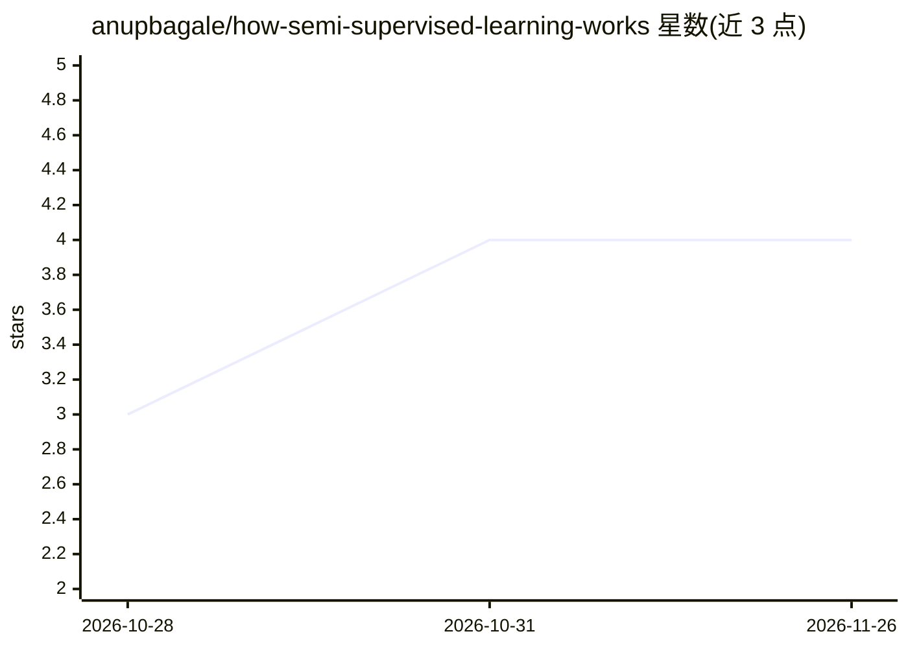

# anupbagale/how-semi-supervised-learning-works

⭐ 4 · Python · MIT · 推送 2026-10-12 · [GitHub](https://github.com/anupbagale/how-semi-supervised-learning-works) · 个人维护

**教程仓库：用脑部 MRI 风格扫描演示 FixMatch 半监督学习及其失效修复**

教学系列第 4 部分：用 4–32 个标注加大量无标注的合成脑部切片训练病灶检测器，逐步拆解 FixMatch 机制（弱/强增强视图、95% 置信度伪标签），展示标准配方在细微病灶上的确认偏误问题，并引入温和强增强与分布对齐（ReMixMatch）两种修复。含准确率对比表、伪标签质量统计与训练过程动画。模型约 1.5 万参数，实验可在笔记本 CPU 上运行，MIT 许可。

## 筛选速览

| 维度 | 判定 | 备注 |
|---|---|---|
| AI 角色 | `ai-knowledge` | 知识聚合/清单类 |
| 许可风险 | `permissive` | MIT |
| 部署形态 | `library` | 以包/库形式分发 |
| 模型依赖 | — | README 未给出锁定关系 |
| 硬件要求 | — | 无带数字的原话,不猜 |
| 安装摩擦 | `low` | 无编译、无系统依赖或容器化 |
| 成熟度 | — | 结构信号不足 |

## 能力要点

- 手写逐步拆解 FixMatch 单步流程（含五行核心代码）
- 展示标准配方在细微病灶上的确认偏误与分布漂移
- 采用温和强增强与分布对齐两种已知修复
- 约 15,000 参数的小 CNN，可在笔记本 CPU 上运行全部实验

## 适用场景

- 学习 FixMatch 半监督学习的内部机制
- 理解伪标签确认偏误的产生与缓解方法
- 在标签稀缺的医学影像场景参考半监督训练配方

## 场景标签

`教程课程` · 领域:学习与行业

## 证据(README 行号)

> L1: How semi-supervised learning works
> L11:  Eight labelled scans and many unlabelled scans; the model guesses a label on a weak view, keeps it only if at leas
> L16: and shows step by step what happens inside it, including where it goes wrong.

## 星数曲线

2026-10-28 3 → 2026-11-26 4（+1）

---
*卡片 v1 · prompt 1.4 · 生成 2026-11-21 · 置信度 high · 依据 README sha `3fc2fc41ab72` · [字段定义](../../DATASET.md)*
