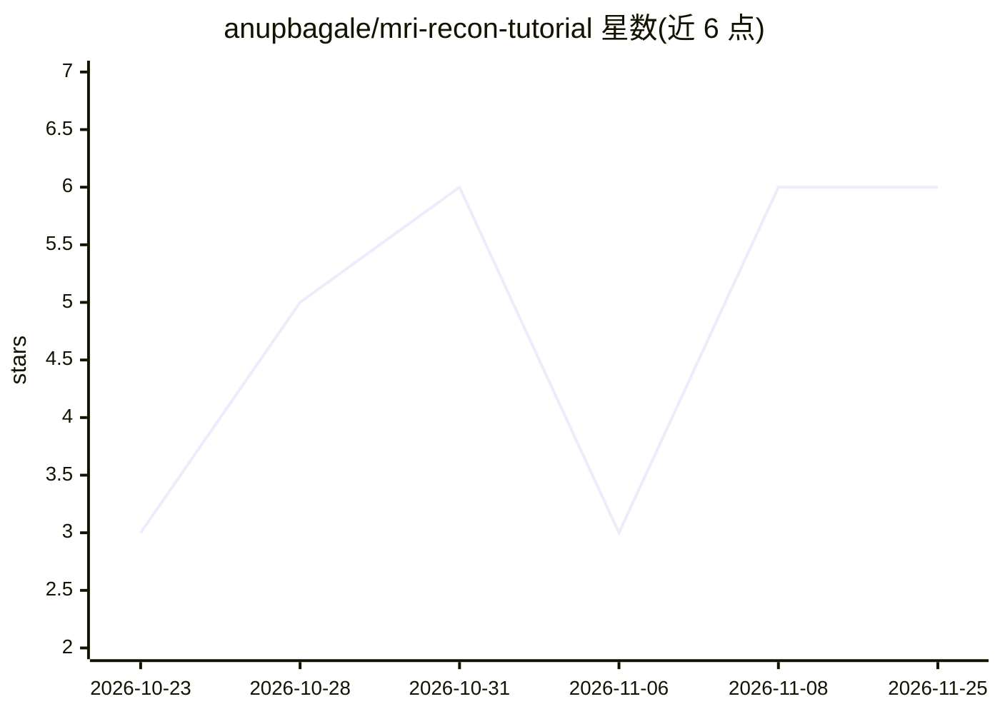

# anupbagale/mri-recon-tutorial

⭐ 6 · Jupyter Notebook · MIT · 推送 2026-10-27 · [GitHub](https://github.com/anupbagale/mri-recon-tutorial) · 个人维护

**面向学生的 MRI 重建动手教学笔记本（6 册）**

一个以 Jupyter notebook 为主的开源教学模块：从傅里叶变换与 k-space 讲到欠采样与压缩感知（ISTA、小波稀疏化），再到 U-Net 与数据一致性展开网络的深度学习重建、评估指标（NRMSE/PSNR/SSIM）与陷阱，最后使用真实多线圈扫描仪数据（M4Raw）。全部 notebook 可在 Google Colab 运行，1–5 册使用模拟幻影数据，无需下载；另附学习目标、练习、带输出的解答和教师指南。

## 筛选速览

| 维度 | 判定 | 备注 |
|---|---|---|
| AI 角色 | `ai-knowledge` | 知识聚合/清单类 |
| 许可风险 | `permissive` | MIT |
| 部署形态 | `library` | 以包/库形式分发 |
| 模型依赖 | — | README 未给出锁定关系 |
| 硬件要求 | — | 无带数字的原话,不猜 |
| 安装摩擦 | `low` | 无编译、无系统依赖或容器化 |
| 成熟度 | — | 结构信号不足 |

## 能力要点

- 6 册 notebook 覆盖 k-space→压缩感知→深度学习重建
- 全部在 Google Colab 运行，1–5 册为模拟数据零下载
- 附教师指南、练习、带输出的解答目录与预训练权重
- 第 6 册使用 CC BY 4.0 许可的 M4Raw 真实多线圈数据

## 适用场景

- 作为研究生/本科高年级 MRI 重建课程的教学材料
- 在 Colab 中逐步动手复现压缩感知与 U-Net 重建
- 教师按 instructor guide 组织课程或工作坊
- 用真实扫描仪数据练习多线圈线圈合成与训练

## 场景标签

`教程课程` · 领域:学习与行业

## 证据(README 行号)

> L5: A hands-on, open learning module that teaches how MRI images are reconstructed: from the Fourier transform and k-spa
> L7: Every concept is introduced by computing it and looking at the result. All notebooks run in Google Colab. Notebooks 

## 星数曲线

2026-10-23 3 → 2026-11-25 6（+3）

---
*卡片 v1 · prompt 1.4 · 生成 2026-11-20 · 置信度 high · 依据 README sha `7b23945f4953` · [字段定义](../../DATASET.md)*
