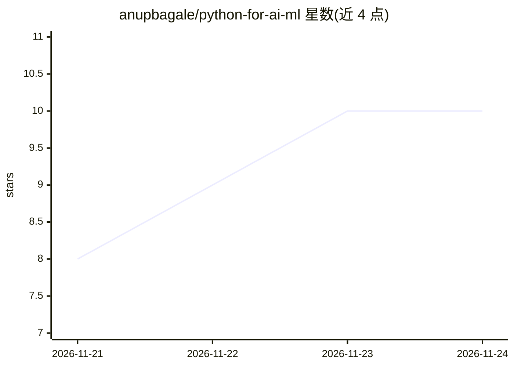

# anupbagale/python-for-ai-ml

⭐ 10 · Jupyter Notebook · MIT · 推送 2026-11-22 · [GitHub](https://github.com/anupbagale/python-for-ai-ml) · 个人维护

**面向 AI/ML 初学者的 Python 动手课程：21 模块、Colab 运行**

从零开始到构建、评估与部署机器学习系统的免费课程，共 21 个模块分三部分：Python 与数据基础、机器学习进阶、深度学习与现代 AI（含 LLM 原理与 LoRA 微调等）。每模块包含课程、带自动检查的练习、解答与迷你项目，总时长约 150-230 小时。全部以 Jupyter notebook 形式提供，默认在 Google Colab 中打开，无需安装，MIT 许可；也可本地运行（Python 3.10+）。

## 筛选速览

| 维度 | 判定 | 备注 |
|---|---|---|
| AI 角色 | `ai-knowledge` | 知识聚合/清单类 |
| 许可风险 | `permissive` | MIT |
| 部署形态 | `library` | 以包/库形式分发 |
| 模型依赖 | — | README 未给出锁定关系 |
| 硬件要求 | — | 无带数字的原话,不猜 |
| 安装摩擦 | `low` | 无编译、无系统依赖或容器化 |
| 成熟度 | `idea` | |

## 能力要点

- 21 个模块，每模块含课程、带检查的练习、解答与迷你项目
- 全部内容以 notebook 形式提供，Colab 徽章一键在浏览器打开
- 练习内置检查单元，可即时验证答案正确性
- 全程使用免费 Colab 与开放数据/模型，不使用付费 API key

## 适用场景

- 零基础入门 Python 与机器学习工程
- 从会写 Python 转向 AI/ML 工程方向
- 理解 NumPy、pandas、PyTorch 底层机制
- 离线自学：克隆仓库后本地运行 notebook

## 场景标签

`教程课程` · 领域:学习与行业

## 证据(README 行号)

> L3: A hands-on course that takes you from your first line of Python to building, evaluating and deploying machine learni
> L7: The course has three parts, all complete. **Part 1** teaches Python, data and machine learning foundations together 
> L18: Everything runs in Google Colab. Click the badge next to any notebook and it opens in your browser, with nothing to

## 星数曲线

2026-11-21 8 → 2026-11-24 10（+2）

---
*卡片 v1 · prompt 1.4 · 生成 2026-11-21 · 置信度 mid · 依据 README sha `905740d91a12` · [字段定义](../../DATASET.md)*
