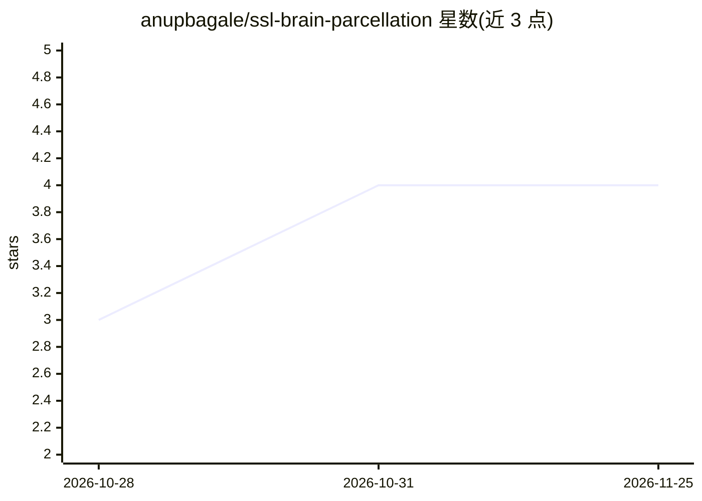

# anupbagale/ssl-brain-parcellation

⭐ 4 · Jupyter Notebook · MIT · 推送 2026-11-15 · [GitHub](https://github.com/anupbagale/ssl-brain-parcellation) · 个人维护

**少标注 MRI 全脑分割的自监督预训练研究代码库**

以 MONAI 3D 残差 U-Net 实现 T1 加权体积的 masked-volume 自监督预训练，再微调分割 27 个 FreeSurfer `aseg` 结构；在 OASIS-3 的 148 名受试者上按 5 折交叉验证，比较 10/25/50/104 张标注扫描下预训练与随机初始化的 Dice、HD95、ASSD 与体积一致性，并统计显著性。以 Jupyter Notebook 形式提供（Colab 运行），数据需自行向 OASIS 申请，仓库不含影像与标签。

## 筛选速览

| 维度 | 判定 | 备注 |
|---|---|---|
| AI 角色 | `ai-native` | 本体是模型或模型工具 |
| 许可风险 | `permissive` | MIT |
| 部署形态 | `library` | 以包/库形式分发 |
| 模型依赖 | — | README 未给出锁定关系 |
| 硬件要求 | — | 无带数字的原话,不猜 |
| 安装摩擦 | `low` | 无编译、无系统依赖或容器化 |
| 成熟度 | — | 结构信号不足 |

## 能力要点

- masked-volume 自监督预训练 + 下游微调的两阶段流程
- 10/25/50/104 标注量 × 5 折交叉验证的标签效率实验
- 报告 Dice、HD95、ASSD、体积相关性与校正 p 值
- 固定种子 42 并提供 folds.json 保证可复现

## 适用场景

- 标注预算有限时训练脑区分割模型
- 复现 OASIS-3 上的自监督预训练对比实验
- 开展临床指标（CDR/MMSE）与分割性能的相关性分析

## 场景标签

`微调` `模型训练` · 领域:训练与推理

## 证据(README 行号)

> L3: Masked-volume self-supervised pretraining for whole-brain MRI parcellation with few labeled scans.
> L5: A 3D residual U-Net (MONAI) is pretrained by reconstructing masked regions of T1-weighted volumes, then fine-tuned t

## 星数曲线

2026-10-28 3 → 2026-11-25 4（+1）

---
*卡片 v1 · prompt 1.4 · 生成 2026-11-21 · 置信度 high · 依据 README sha `2ab7279255ad` · [字段定义](../../DATASET.md)*
