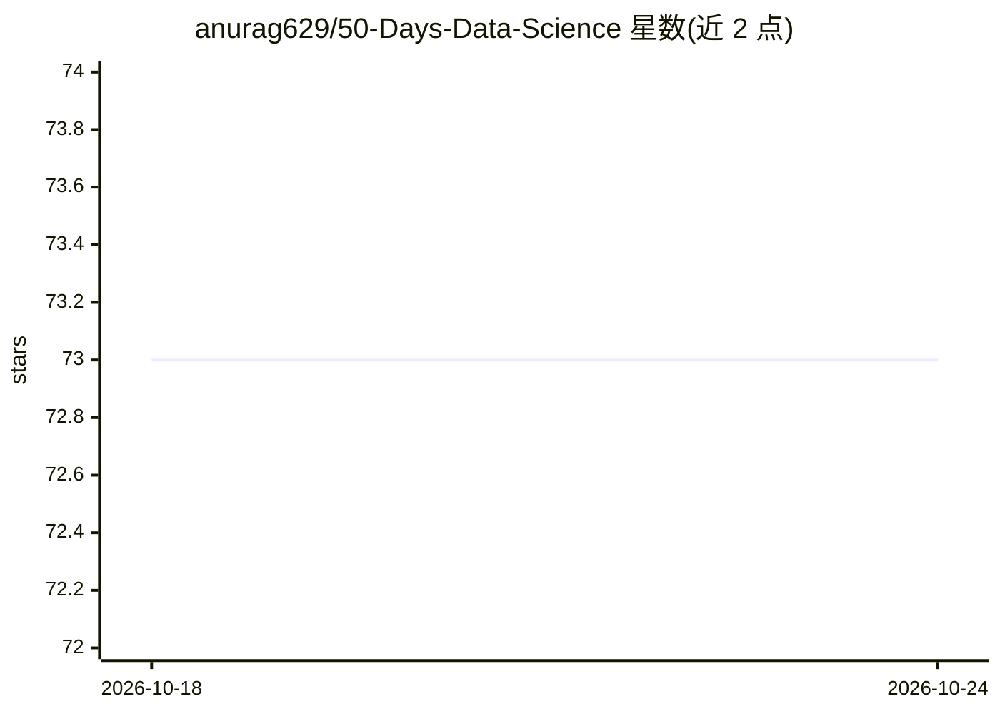

# anurag629/50-Days-Data-Science

⭐ 73 · Jupyter Notebook · MIT · 推送 2026-10-11 · [GitHub](https://github.com/anurag629/50-Days-Data-Science) · [官网](https://anurag629.github.io/50-Days-Data-Science/) · 个人维护

**50 天数据科学学习路线：Python、SQL 与机器学习**

面向数据科学初学者的 50 天学习路线仓库：以逐日文章链接组织内容，从 Python 基础、数据结构、NumPy/Pandas、可视化、SQL 讲到统计/概率/线性代数/微积分复习、EDA、监督与无监督学习、时间序列、聚类及多个实战项目，另含 Tableau 模块。配套 CODERCOPS Discord 社区，提供每日打卡与学习记录追踪机器人，练习与材料放在关联的 GitHub 仓库。README 本身不提供代码或安装命令。

## 筛选速览

| 维度 | 判定 | 备注 |
|---|---|---|
| AI 角色 | `ai-knowledge` | 知识聚合/清单类 |
| 许可风险 | `permissive` | MIT |
| 部署形态 | `None` |  |
| 模型依赖 | — | README 未给出锁定关系 |
| 硬件要求 | — | 无带数字的原话,不猜 |
| 安装摩擦 | `low` | 无编译、无系统依赖或容器化 |
| 成熟度 | — | 结构信号不足 |

## 能力要点

- 50 天逐日排课覆盖 Python/SQL/数学/EDA/机器学习/Tableau
- 含 6 个以上实战项目（房价预测、垃圾邮件分类、情感分析等）
- 配套 Discord 社区与每日打卡 streak 追踪机器人
- 内容另以模块-主题-子主题的表格形式重复组织

## 适用场景

- 按天跟着路线自学数据科学入门
- 查找数据科学各阶段的学习主题与项目练习
- 在社区中打卡并追踪学习进度

## 场景标签

`教程课程` · 领域:学习与行业

## 证据(README 行号)

> L1: Welcome to the Data Science course! Over the next 50 days, you will learn a wide range of topics related to Python p
> L16: |**Day**|**Content**|**Article Links**|

## 星数曲线

2026-10-18 73 → 2026-10-24 73（+0）

---
*卡片 v1 · prompt 1.4 · 生成 2026-10-24 · 置信度 high · 依据 README sha `4d44d1afe1fa` · [字段定义](../../DATASET.md)*
