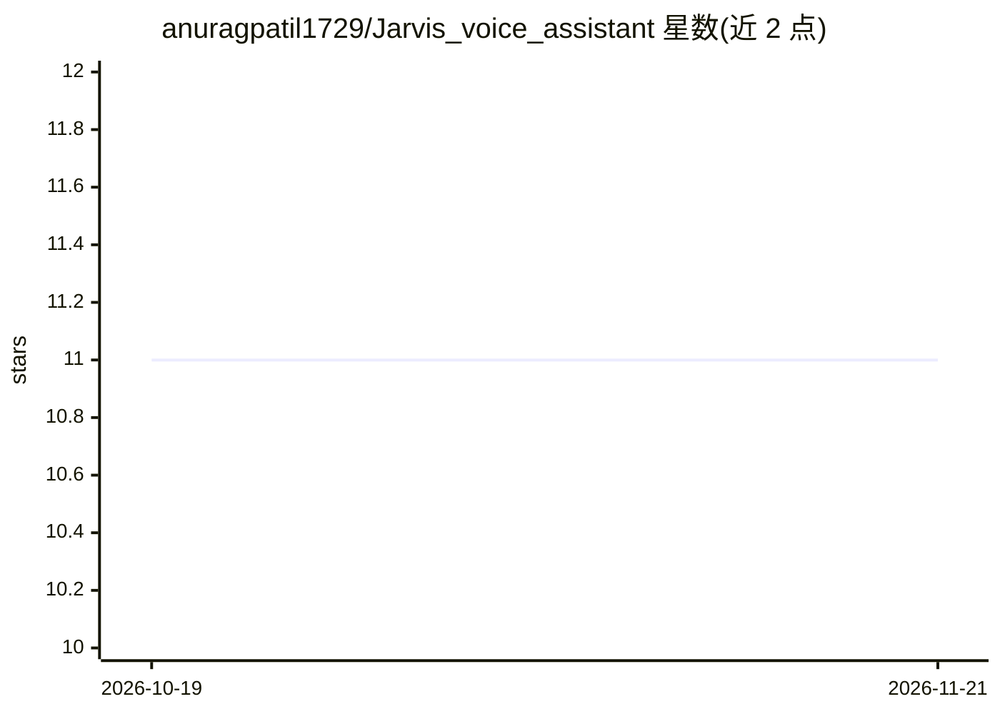

# anuragpatil1729/Jarvis_voice_assistant

⭐ 11 · Python · 推送 2025-12-07 · [GitHub](https://github.com/anuragpatil1729/Jarvis_voice_assistant) · 个人维护

**macOS 用户的 Gemini 语音助手：语音控制电脑与日常任务**

运行于 macOS 的个人语音助手，接入 Google Gemini 2.5 Flash（含 Google Search 的持久会话）。语音/文本双模式切换，支持口令启动应用、调节音量、管理桌面文件、截屏、打开 YouTube/GitHub 等网站、自然语言设闹钟、发 WhatsApp 消息、维护待办与个人信息记忆（本地 JSON 存储）。需 Python 3.8+ 与 Gemini API key，带密码认证（3 次尝试限制），部分功能仅限 macOS。

## 筛选速览

| 维度 | 判定 | 备注 |
|---|---|---|
| AI 角色 | `ai-native` | 本体是模型或模型工具 |
| 许可风险 | `none` | — |
| 部署形态 | `library` | 以包/库形式分发 |
| 模型依赖 | — | README 未给出锁定关系 |
| 硬件要求 | — | 无带数字的原话,不猜 |
| 安装摩擦 | `low` | 无编译、无系统依赖或容器化 |
| 成熟度 | — | 结构信号不足 |

## 能力要点

- 语音/文本双模式命令输入，SpeechRecognition 识别
- Gemini 2.5 Flash 持久会话并支持 Google Search
- macOS 应用启动、音量、文件、截图等系统控制
- 本地 JSON 存储记忆与任务，密码认证进入

## 适用场景

- 口令打开应用、调音量、截屏等日常操作
- 让助手记住生日等个人信息并随时询问
- 自然语言设置闹钟和管理待办清单
- 向 WhatsApp 联系人发送或定时发消息

## 场景标签

`语音 Agent` `AI 助手` · 领域:对话与助手

## 证据(README 行号)

> L3: A sophisticated voice-activated AI assistant powered by Google's Gemini 2.5 Flash, designed to help you manage tasks
> L9: - **Gemini AI Integration**: Persistent chat sessions with Google Search capabilities
> L29: - macOS (for system-specific features)

## 星数曲线

2026-10-19 11 → 2026-11-21 11（+0）

---
*卡片 v1 · prompt 1.4 · 生成 2026-11-18 · 置信度 high · 依据 README sha `4d4e74baa91b` · [字段定义](../../DATASET.md)*
