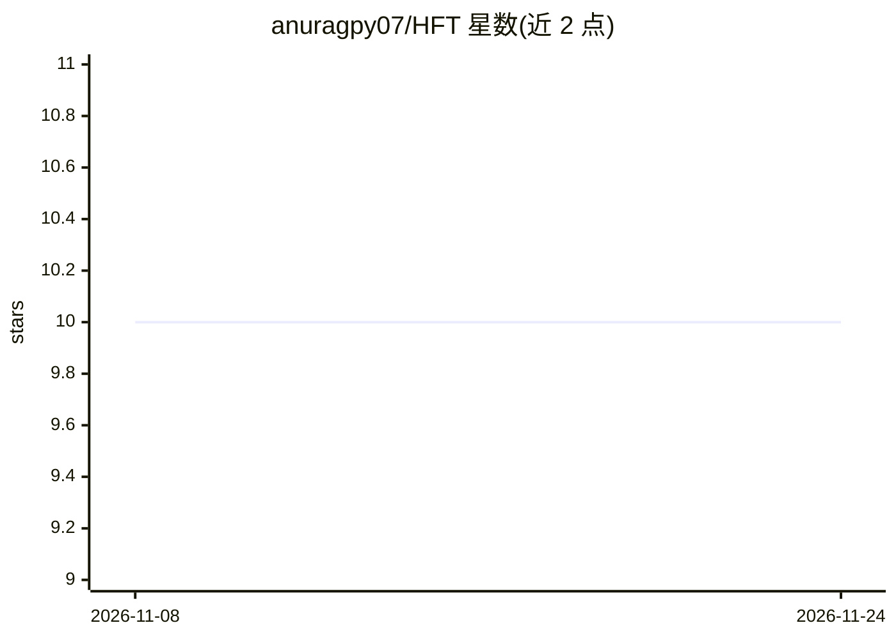

# anuragpy07/HFT

⭐ 10 · Jupyter Notebook · 推送 2025-11-29 · [GitHub](https://github.com/anuragpy07/HFT) · 个人维护

**期货高频交易框架：从 Level-II 订单簿提取信号并预测动态**

面向期货高频交易的研究型框架/流水线：从 Level-II 订单簿 tick 级深度数据（示例为 SGX FTSE 中国 A50 指数期货）中提取 Depth Ratio、Rise Ratio、Order Book Imbalance 等信号，进行加权平均等特征工程，训练 RandomForest、AdaBoost、SVM、MLP、LSTM 等分类模型，以 15 分钟前向价格变动为预测标签，输出预测准确率、交叉验证均值与 PnL 可视化。README 称项目仅提供 baseline，无安装与运行说明。

## 筛选速览

| 维度 | 判定 | 备注 |
|---|---|---|
| AI 角色 | `ai-native` | 本体是模型或模型工具 |
| 许可风险 | `none` | — |
| 部署形态 | `None` |  |
| 模型依赖 | — | README 未给出锁定关系 |
| 硬件要求 | — | 无带数字的原话,不猜 |
| 安装摩擦 | `low` | 无编译、无系统依赖或容器化 |
| 成熟度 | — | 结构信号不足 |

## 能力要点

- 从 Level-II 订单簿数据提取 Depth Ratio、Rise Ratio、OBI 等交易信号
- 集成 RandomForest/ExtraTrees/AdaBoost/GBDT/SVM/KNN/MLP/LSTM 等分类模型
- 30 分钟训练窗口、10 秒测试窗口、15 分钟前向预测标签的拟合设置
- 输出预测准确率序列、交叉验证均值与 PnL 可视化

## 适用场景

- 研究订单簿失衡类信号在期货高频数据上的预测能力
- 搭建机器学习价格方向预测的研究流水线
- 在 tick 级深度/成交/报价数据上做特征工程实验

## 场景标签

`金融量化` · 领域:学习与行业

## 证据(README 行号)

> L3: In this project, we provide a framework/pipeline for high-frequency trading using machine learning and deep learning
> L7: - Predict order book dynamics using machine learning and deep learning techniques

## 星数曲线

2026-11-08 10 → 2026-11-24 10（+0）

---
*卡片 v1 · prompt 1.4 · 生成 2026-11-20 · 置信度 high · 依据 README sha `f3a3c951541a` · [字段定义](../../DATASET.md)*
