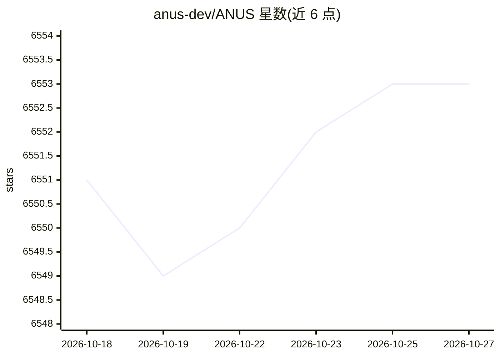

# anus-dev/ANUS

⭐ 6,553 · JavaScript · MIT · 推送 2026-10-01 · [GitHub](https://github.com/anus-dev/ANUS) · [官网](https://anus.dev) · 个人维护

**终端免费编码 agent：自动在多个免费模型间路由请求**

基于 pi 引擎（Earendil Works，MIT）构建的终端编码代理：读代码、编辑文件、运行命令。核心机制是免费模型路由器——维护从 anus.dev 拉取的免费模型排名列表（每日刷新两次），请求发给当前最优且未限流的模型，命中速率限制或中断时自动切换下一个。需要至少一个免费 API key（OpenRouter/Gemini/Groq/Mistral 等），配置存于 ~/.anus/agent。以 npm 全局包或 curl 安装脚本分发，需 Node.js 22.19+。

## 筛选速览

| 维度 | 判定 | 备注 |
|---|---|---|
| AI 角色 | `ai-native` | 本体是模型或模型工具 |
| 许可风险 | `permissive` | MIT |
| 部署形态 | `library` | 以包/库形式分发 |
| 模型依赖 | locked-api |  |
| 硬件要求 | — | 无带数字的原话,不猜 |
| 安装摩擦 | `low` | 无编译、无系统依赖或容器化 |
| 成熟度 | — | 结构信号不足 |

## 能力要点

- 免费模型自动路由与故障切换（限流/中断自动换模型）
- 支持 OpenRouter、Gemini、Groq、Mistral 等免费 key 通道
- `anus -p "task"` 单任务模式与会话续接（`-c`）
- 忽略 shell 中的付费 key，避免产生费用

## 适用场景

- 不付费获得可读码、改文件、跑命令的终端编码助手
- 免费额度内最大化可用请求数（多 key 叠加）
- CI 或脚本中单次任务式调用编码 agent

## 场景标签

`编码 Agent` · 领域:编码与开发

## 证据(README 行号)

> L9: **A free coding agent in your terminal.** It reads your code, edits files and runs commands, like the paid ones. The
> L44: - ANUS keeps a ranked list of free models: which ones are smartest, and which answered a ping in the last hours. Th

## 星数曲线

2026-10-18 6,551 → 2026-10-27 6,553（+2）

---
*卡片 v1 · prompt 1.4 · 生成 2026-10-20 · 置信度 high · 依据 README sha `bb61dab281fc` · [字段定义](../../DATASET.md)*
