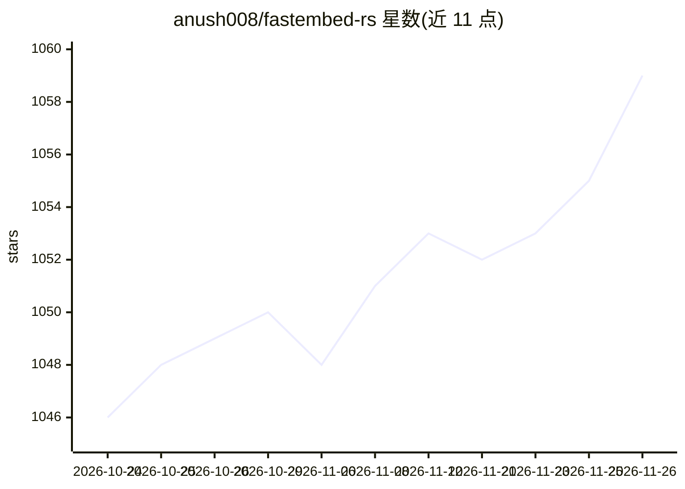

# anush008/fastembed-rs

⭐ 1,059 · Rust · Apache-2.0 · 推送 2026-11-22 · [GitHub](https://github.com/anush008/fastembed-rs) · [官网](https://docs.rs/fastembed) · 个人维护

**Rust 开发者本地生成向量嵌入与重排序的库**

一个 Rust 库，通过 ONNX（ort）与 Hugging Face tokenizers 在本地运行文本/图像嵌入模型与重排序模型，无需 Tokio 运行时。内置 30+ 文本嵌入模型、稀疏嵌入、图像嵌入（CLIP/Unicom 等）与 4 个 reranker；部分模型（Qwen3、BERT、nomic-v2-moe）经 candle 后端以 feature flag 提供，支持 GGUF 量化、Metal/CUDA/DirectML 执行提供者。模型首次使用时下载并缓存。通过 cargo add 引入。

## 筛选速览

| 维度 | 判定 | 备注 |
|---|---|---|
| AI 角色 | `ai-native` | 本体是模型或模型工具 |
| 许可风险 | `permissive` | Apache-2.0 |
| 部署形态 | `None` |  |
| 模型依赖 | — | README 未给出锁定关系 |
| 硬件要求 | — | 无带数字的原话,不猜 |
| 安装摩擦 | `medium` | 含编译或系统依赖之一 |
| 成熟度 | — | 结构信号不足 |

## 能力要点

- 本地生成文本/图像/稀疏嵌入与候选重排序，同步调用无需 Tokio
- 支持量化模型与 GGUF 权重加载
- feature flag 接入 candle 后端（Qwen3、BERT、Metal/CUDA）
- 内置 similarity 模块做内存内余弦相似度检索

## 适用场景

- 在 Rust 服务中本地生成文本向量用于语义搜索
- 为 RAG 流程补充重排序步骤
- 离线或受限网络环境下运行嵌入推理（模型缓存/镜像）

## 场景标签

`语义搜索` · 领域:知识与检索

## 证据(README 行号)

> L2:  Rust library for generating vector embeddings, reranking locally!
> L8: - Uses @pykeio/ort for performant ONNX inference.

## 星数曲线

2026-10-24 1,046 → 2026-11-26 1,059（+13）

---
*卡片 v1 · prompt 1.4 · 生成 2026-11-25 · 置信度 high · 依据 README sha `9dcf6be56691` · [字段定义](../../DATASET.md)*
