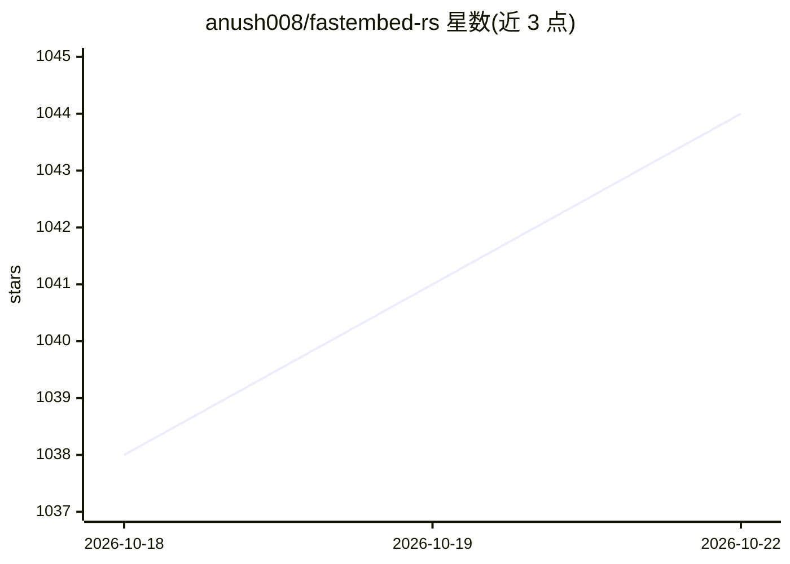

# anush008/fastembed-rs

⭐ 1,044 · Rust · Apache-2.0 · 推送 2026-10-21 · [GitHub](https://github.com/anush008/fastembed-rs) · [官网](https://docs.rs/fastembed) · 个人维护

**本地生成向量嵌入与重排序的 Rust 库**

Rust 嵌入与重排序库：基于 pykeio/ort 做 ONNX 本地推理，支持文本/稀疏文本/图像嵌入与候选重排序，内置 BGE、Qwen3-Embedding、Nomic、CLIP 等数十个模型，模型首次使用时下载并缓存，之后无需网络。Qwen3 与 Nomic v2 MoE 系列经 candle 后端特性开关提供；Windows 可通过 directml 特性用 DirectML 跑 GPU。附带相似度计算辅助模块与类型化错误处理，面向 Rust 开发者以 cargo 集成。

## 筛选速览

| 维度 | 判定 | 备注 |
|---|---|---|
| AI 角色 | `ai-native` | 本体是模型或模型工具 |
| 许可风险 | `permissive` | Apache-2.0 |
| 部署形态 | `None` |  |
| 模型依赖 | — | README 未给出锁定关系 |
| 硬件要求 | — | 无带数字的原话,不猜 |
| 安装摩擦 | `low` | 无编译、无系统依赖或容器化 |
| 成熟度 | — | 结构信号不足 |

## 能力要点

- 文本/稀疏/图像嵌入与重排序四类能力，支持数十个预置模型
- ONNX 本地推理，模型缓存后运行时无需网络
- Qwen3 系列（含 VL 多模态）与 Nomic v2 MoE 经特性开关提供
- 内置相似度评分与 top_k 辅助，支持 DirectML GPU

## 适用场景

- 在 Rust 项目中本地生成 RAG 所需的文本嵌入
- 对检索候选做本地重排序
- 图像-文本跨模态嵌入检索

## 场景标签

`语义搜索` · 领域:知识与检索

## 证据(README 行号)

> L2:  Rust library for generating vector embeddings, reranking locally!
> L8: - Uses @pykeio/ort for performant ONNX inference.

## 星数曲线

2026-10-18 1,038 → 2026-10-22 1,044（+6）

---
*卡片 v1 · prompt 1.4 · 生成 2026-10-21 · 置信度 high · 依据 README sha `85b11344c2ef` · [字段定义](../../DATASET.md)*
