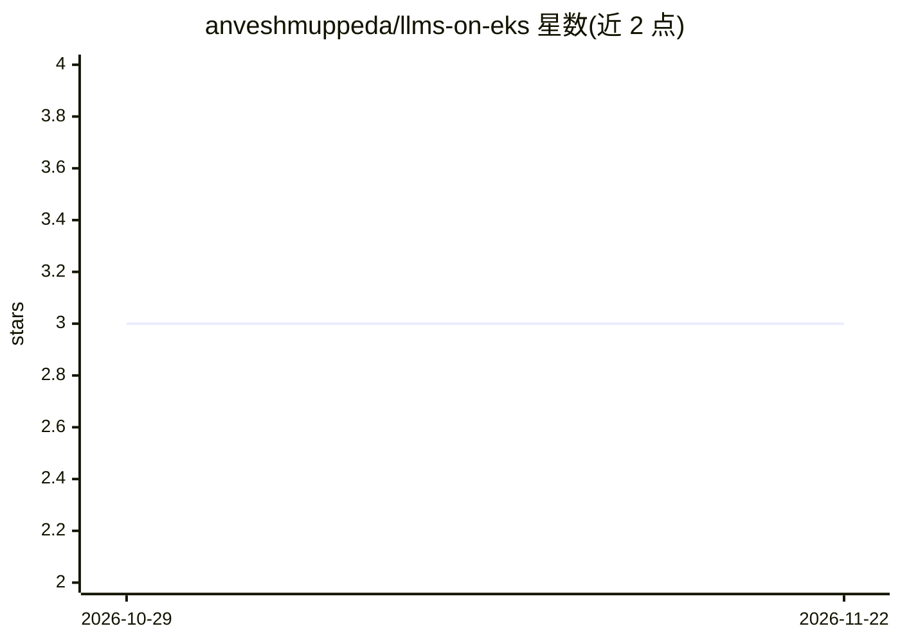

# anveshmuppeda/llms-on-eks

⭐ 3 · Shell · MIT · 推送 2026-10-27 · [GitHub](https://github.com/anveshmuppeda/llms-on-eks) · 个人维护

**在 Amazon EKS 上运行开源 LLM 的系列实操教程**

面向 AWS/Kubernetes 用户的分篇实操指南系列：每篇为自含目录，含基础设施代码（CloudFormation）、Kubernetes manifests、shell 脚本、基准测试结果与说明文档。已发布 3 篇：EKS 集群与 Karpenter 搭建、vLLM CPU 推理、vLLM GPU（A10G）推理；规划 9 篇涵盖 EFS 模型存储、LiteLLM 网关、KEDA 扩缩容、GPU Operator、监控、压测、SGLang、多节点 70B 与 NVIDIA NIM。安装方式为 git clone 后执行脚本，附各场景每小时成本表。

## 筛选速览

| 维度 | 判定 | 备注 |
|---|---|---|
| AI 角色 | `ai-knowledge` | 知识聚合/清单类 |
| 许可风险 | `permissive` | MIT |
| 部署形态 | `None` |  |
| 模型依赖 | — | README 未给出锁定关系 |
| 硬件要求 | — | 无带数字的原话,不猜 |
| 安装摩擦 | `low` | 无编译、无系统依赖或容器化 |
| 成熟度 | — | 结构信号不足 |

## 能力要点

- 3 篇已发布指南含可运行基础设施代码、manifests 与脚本
- 附 CPU（t3.2xlarge + Llama 3.2 1B）与 GPU（g5.xlarge）实测基准数据
- 共享 EKS 集群一次搭建，后续指南复用；GPU 节点空闲约 5 分钟内自动终止
- 列明各场景每分钟/每小时成本与 scale-to-zero 机制

## 适用场景

- 在 EKS 上从零搭建 vLLM 推理集群
- 了解 GPU 推理相对 CPU 的吞吐基准数据
- 规划 LLM 推理的存储、扩缩容与监控方案

## 场景标签

`教程课程` `推理引擎` · 领域:学习与行业

## 证据(README 行号)

> L3: **Hands-on guide series for running open-source Large Language Models on Amazon EKS.**
> L5: Each guide is a self-contained directory with working infrastructure code, Kubernetes manifests,
> L28: |#|Guide|What you learn|GPU|Cost/hr|Time|

## 星数曲线

2026-10-29 3 → 2026-11-22 3（+0）

---
*卡片 v1 · prompt 1.4 · 生成 2026-11-22 · 置信度 high · 依据 README sha `0a086947937d` · [字段定义](../../DATASET.md)*
