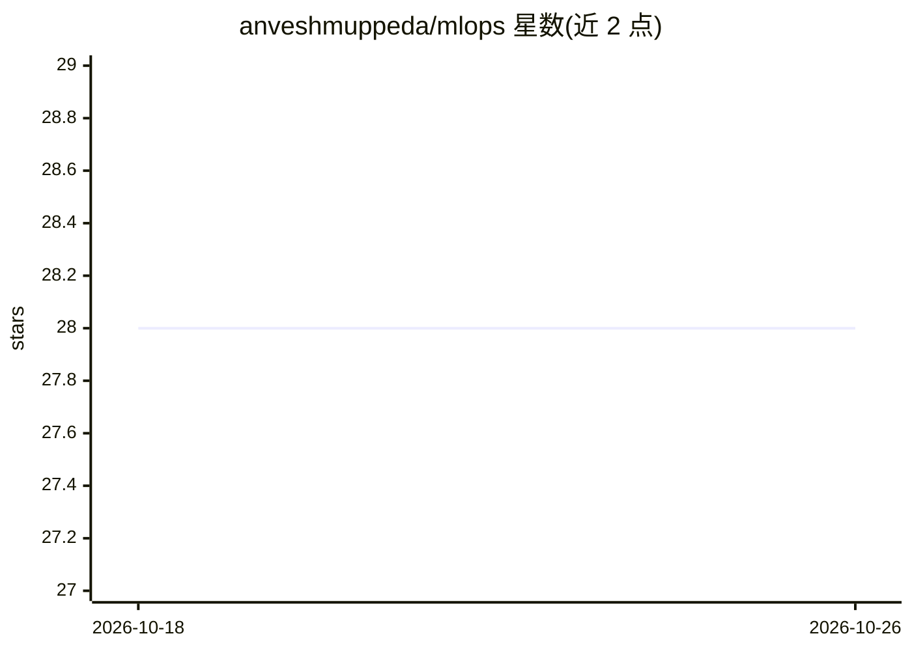

# anveshmuppeda/mlops

⭐ 28 · Jupyter Notebook · GPL-3.0 · 推送 2026-01-22 · [GitHub](https://github.com/anveshmuppeda/mlops) · 个人维护

**AWS 上的 MLOps 端到端实现指南与模板仓库**

演示使用 AWS 原生服务实现端到端 MLOps 的代码仓库，覆盖完整机器学习生命周期：数据摄取与预处理、模型训练与验证、自动化部署、性能监控与合规、ML 工作流的 CI/CD。以实践示例和模板形式提供，面向在 AWS 上构建 ML 流水线的工程师。README 仅含项目概览、支持渠道与资源链接；Bedrock 集成、GitOps、Kubernetes 原生工作流等列为未完成路线图项，仓库内容深度无法从 README 验证。

## 筛选速览

| 维度 | 判定 | 备注 |
|---|---|---|
| AI 角色 | `ai-knowledge` | 知识聚合/清单类 |
| 许可风险 | `viral` | GPL-3.0 |
| 部署形态 | `None` |  |
| 模型依赖 | — | README 未给出锁定关系 |
| 硬件要求 | — | 无带数字的原话,不猜 |
| 安装摩擦 | `low` | 无编译、无系统依赖或容器化 |
| 成熟度 | — | 结构信号不足 |

## 能力要点

- 覆盖数据工程、模型开发、部署、监控与 CI/CD 五个环节的模板
- 使用 AWS 原生工具与服务（SageMaker、ECR、CDK 相关文档引用）
- MIT 许可，通过 GitHub Issues/Discussions 提供支持

## 适用场景

- 在 AWS 上搭建 ML 流水线时参考实现模板
- 学习 MLOps 全生命周期在云端的落地方式

## 场景标签

`MLOps` `教程课程` · 领域:学习与行业

## 证据(README 行号)

> L28: A comprehensive repository demonstrating end-to-end MLOps implementation using AWS services. This project covers th
> L32: This repository provides practical examples and templates for implementing MLOps pipelines on AWS, covering:

## 星数曲线

2026-10-18 28 → 2026-10-26 28（+0）

---
*卡片 v1 · prompt 1.4 · 生成 2026-10-26 · 置信度 mid · 依据 README sha `dda4778f1d19` · [字段定义](../../DATASET.md)*
