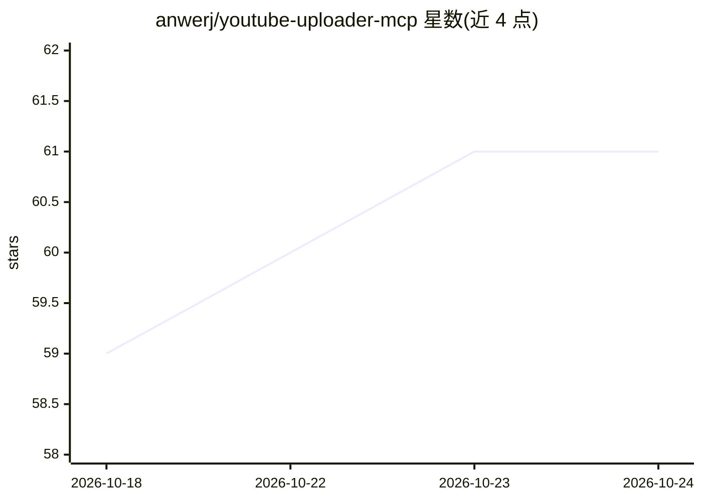

# anwerj/youtube-uploader-mcp

⭐ 61 · Go · MIT · 推送 2026-09-20 · [GitHub](https://github.com/anwerj/youtube-uploader-mcp) · 个人维护

**通过 MCP 客户端上传/更新/排期 YouTube 视频的服务器**

一个 MCP 服务器，注册 authenticate、upload_video、update_video、list_videos 等工具，让 Claude Desktop、Cursor、VS Code 等 MCP 客户端直接上传、更新、排期 YouTube 视频，并可由客户端生成标题、描述与标签。提供 OAuth2 本地登录、多频道支持与 token 自动刷新，声明不向 LLM 或第三方应用共享密钥。支持单命令安装（Mac/Linux/Windows）或从 Releases 下载二进制手动配置。

## 筛选速览

| 维度 | 判定 | 备注 |
|---|---|---|
| AI 角色 | `ai-ecosystem` | LLM/agent 周边工具 |
| 许可风险 | `permissive` | MIT |
| 部署形态 | `desktop` | 安装包/桌面程序 |
| 模型依赖 | — | README 未给出锁定关系 |
| 硬件要求 | — | 无带数字的原话,不猜 |
| 安装摩擦 | `low` | 无编译、无系统依赖或容器化 |
| 成熟度 | — | 结构信号不足 |

## 能力要点

- MCP 工具覆盖上传、更新、列表与 OAuth 认证流程
- 支持公开/私享/不公开状态与定时发布
- update_video 支持播放列表、自定义缩略图(<2MB)、字幕与儿童设置
- OAuth2 本地登录、多频道与 token 自动刷新

## 适用场景

- 我在 Claude 或 Cursor 里直接上传视频到 YouTube
- 让 AI 生成标题、描述和标签再发布
- 对已上传视频补缩略图、字幕或改定时发布

## 场景标签

 · 领域:内容创作/自动化工具

## 证据(README 行号)

> L9: * **Direct Uploads**: Upload videos to YouTube from Claude, Cursor, VS Code, or any other MCP client.
> L81: The MCP server registers the following tools:

## 星数曲线

2026-10-18 59 → 2026-10-24 61（+2）

---
*卡片 v1 · prompt 1.4 · 生成 2026-10-24 · 置信度 high · 依据 README sha `6ddae655d420` · [字段定义](../../DATASET.md)*
