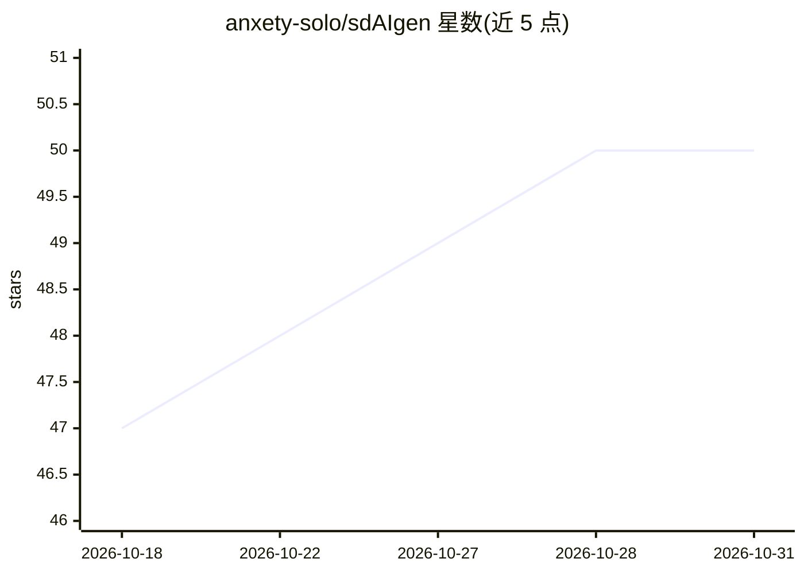

# anxety-solo/sdAIgen

⭐ 50 · Python · GPL-3.0 · 推送 2026-10-26 · [GitHub](https://github.com/anxety-solo/sdAIgen) · [官网](https://anxety-solo.github.io) · 个人维护 · 中文 README

**在 Colab/Kaggle 上一键部署 Stable Diffusion 各类 WebUI 的笔记本**

面向 Google Colab 与 Kaggle 平台的单一笔记本，用于部署多个 Stable Diffusion 前端：A1111、ComfyUI、Forge、Forge-Classic/Neo、ReForge、SD-UX。提供交互式 widgets、自定义预设（设置+风格+UI 主题）、从 CivitAI 下载模型/LoRA/嵌入预览；Colab 独有 Google Drive 连接（文件、输出、UI 配置）。为各 WebUI 预装约 19 个扩展，为 ComfyUI 预装约 11 个自定义节点（含 ControlNet-AUX、Impact-Pack、ComfyUI-GGUF 等）。使用方式为在 Colab/Kaggle 打开运行笔记本，不提供本地安装命令。

## 筛选速览

| 维度 | 判定 | 备注 |
|---|---|---|
| AI 角色 | `ai-ecosystem` | LLM/agent 周边工具 |
| 许可风险 | `viral` | GPL-3.0 |
| 部署形态 | `None` |  |
| 模型依赖 | — | README 未给出锁定关系 |
| 硬件要求 | — | 无带数字的原话,不猜 |
| 安装摩擦 | `low` | 无编译、无系统依赖或容器化 |
| 成熟度 | — | 结构信号不足 |

## 能力要点

- 单笔记本支持 6 种 WebUI 选择（A1111/ComfyUI/Forge/Classic/Neo/ReForge/SD-UX）
- 交互式 widgets 与自定义预设（设置+风格+UI 主题）
- 从 CivitAI 下载模型、LoRA 与嵌入预览
- 为各 WebUI 预装约 19 个扩展、为 ComfyUI 预装约 11 个自定义节点

## 适用场景

- 没有本地 GPU 时在云端运行 Stable Diffusion WebUI
- 在 Kaggle 或 Colab 上快速搭建 ComfyUI 工作流环境
- 通过 Google Drive 持久化保存模型输出与配置

## 场景标签

`图像生成` · 领域:内容生成

## 证据(README 行号)

> L22:  - Multiplatform notebook: *Google Colab, Kaggle.*
> L26:  - Choosing WebUI between *A1111, ComfyUI, Forge, Classic/Neo (Forge), ReForge, SD-UX.*

## 星数曲线

2026-10-18 47 → 2026-10-31 50（+3）

---
*卡片 v1 · prompt 1.4 · 生成 2026-10-25 · 置信度 high · 依据 README sha `28f25978f520` · [字段定义](../../DATASET.md)*
