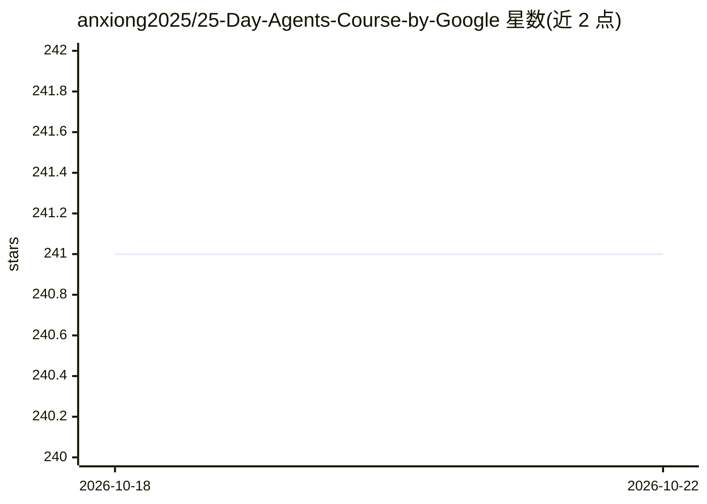

# anxiong2025/25-Day-Agents-Course-by-Google

⭐ 241 · Jupyter Notebook · 推送 2025-12-31 · [GitHub](https://github.com/anxiong2025/25-Day-Agents-Course-by-Google) · 个人维护 · 中文 README

**谷歌 25 天 AI Agents 课程的学习仓库与练习集**

Google Cloud 'Advent of Agents 2025' 课程的配套学习仓库：25 天每日一个主题，覆盖 Gemini 3、Agent Development Kit (ADK)、Agent Engine 部署、MCP、A2A 远程代理、多模态流式代理、安全护栏等内容，全部 25 天标记完成。每课提供可直接复制的命令与官方文档链接，要求先修 5 天 AI Agents 课程。运行需 Python 3.11+ 与 uv 包管理器，配置 GOOGLE_API_KEY 后用 uv run 执行每日脚本。面向学习 Google AI Agent 技术栈的开发者。

## 筛选速览

| 维度 | 判定 | 备注 |
|---|---|---|
| AI 角色 | `ai-knowledge` | 知识聚合/清单类 |
| 许可风险 | `none` | — |
| 部署形态 | `None` |  |
| 模型依赖 | — | README 未给出锁定关系 |
| 硬件要求 | — | 无带数字的原话,不猜 |
| 安装摩擦 | `low` | 无编译、无系统依赖或容器化 |
| 成熟度 | — | 结构信号不足 |

## 能力要点

- 25 天课程结构，每日一个功能点、5 分钟内可上手
- 练习覆盖 Gemini 3 / ADK / Agent Engine / MCP / A2A 等 Google 技术栈
- 提供每日脚本的运行命令与 pytest 测试路径
- 100% 免费，附官方文档链接

## 适用场景

- 按天学习 Google AI Agents 技术栈并运行示例
- 作为 ADK 与 Agent Engine 的动手入门材料
- 查阅每日主题（MCP、A2A、护栏、遥测等）作为学习路线图

## 场景标签

`教程课程` · 领域:学习与行业

## 证据(README 行号)

> L9: This is Google Cloud's **Advent of Agents 2025** program - a 25-day journey to master AI Agents using:
> L57: |01|Introduction to AI Agents|✅ Done|

## 星数曲线

2026-10-18 241 → 2026-10-22 241（+0）

---
*卡片 v1 · prompt 1.4 · 生成 2026-10-22 · 置信度 high · 依据 README sha `f6e34e5d0689` · [字段定义](../../DATASET.md)*
