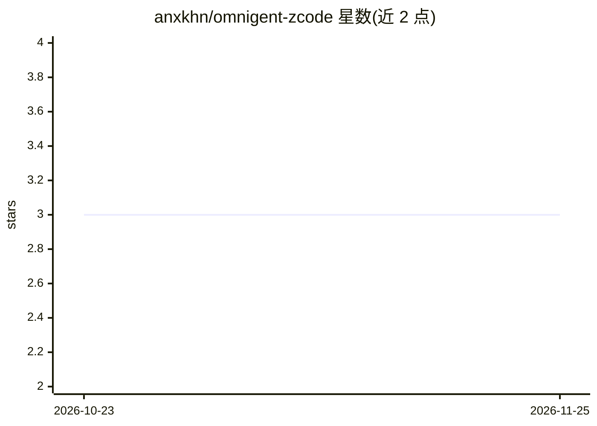

# anxkhn/omnigent-zcode

⭐ 3 · Python · Apache-2.0 · 推送 2026-10-12 · [GitHub](https://github.com/anxkhn/omnigent-zcode) · 个人维护

**把 ZCode 编码代理接入 Omnigent 会话的社区插件**

omnigent-zcode 是 Omnigent 的社区 harness 插件，通过 ZCode CLI 的 print 模式（yolo 权限）在 Omnigent 会话中运行 Z.ai 的 ZCode 编码代理。每轮启动无头 ZCode 进程，把 stream-json 事件翻译为 Omnigent 事件，支持流式输出、工具调用展示、基于 --resume 的多轮续接、文件/图片附件传递、进程树级取消与 10 分钟超时限制。凭据与模型选择由 ZCode 自身管理，插件不复制其凭据；仅支持 yolo 权限模式，Omnigent 工具策略无法拦截 ZCode 内部工具调用，建议配合 OS 沙箱使用。

## 筛选速览

| 维度 | 判定 | 备注 |
|---|---|---|
| AI 角色 | `ai-ecosystem` | LLM/agent 周边工具 |
| 许可风险 | `permissive` | Apache-2.0 |
| 部署形态 | `library` | 以包/库形式分发 |
| 模型依赖 | — | README 未给出锁定关系 |
| 硬件要求 | — | 无带数字的原话,不猜 |
| 安装摩擦 | `low` | 无编译、无系统依赖或容器化 |
| 成熟度 | — | 结构信号不足 |

## 能力要点

- 通过 ZCode CLI print 模式流式转发文本、推理与工具事件
- 基于 ZCode 持久化 session ID 实现多轮续接（--resume）
- 支持 agent YAML 配置、源码构建指向与 workflow_mode 选项
- 10 分钟每轮超时与进程树级取消

## 适用场景

- 在 Omnigent 会话里让 ZCode 探索仓库、修复测试或解释代码
- 用 agent YAML 定义固定 prompt 的编码助手执行器
- 在多台服务器/主机上为 Omnigent 统一接入 ZCode

## 场景标签

`编码 Agent` · 领域:编码与开发

## 证据(README 行号)

> L11: `omnigent-zcode` is a community harness for Omnigent
> L94: Omnigent session connects through the plugin to the ZCode CLI, which sends streamed events back

## 星数曲线

2026-10-23 3 → 2026-11-25 3（+0）

---
*卡片 v1 · prompt 1.4 · 生成 2026-11-22 · 置信度 mid · 依据 README sha `b4cd39c38749` · [字段定义](../../DATASET.md)*
