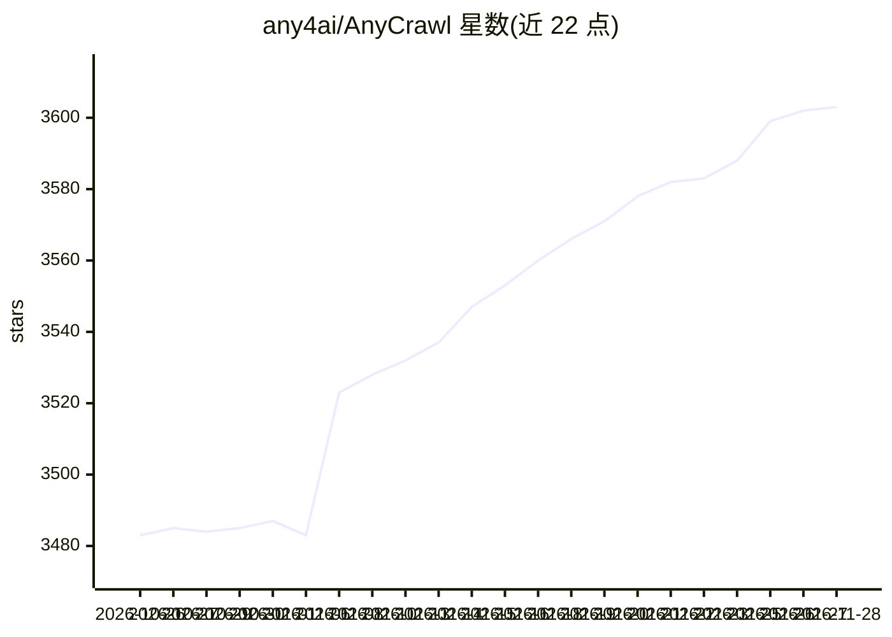

# any4ai/AnyCrawl

⭐ 3,603 · TypeScript · MIT · 推送 2026-11-12 · [GitHub](https://github.com/any4ai/AnyCrawl) · [官网](https://anycrawl.dev) · 组织维护

**把网页转为 LLM 可用数据的 Node.js 爬虫工具包**

Node.js/TypeScript 编写的爬取与抓取工具包，提供三类能力：SERP 抓取、单页内容提取、整站遍历爬取，支持多线程/多进程与批量任务。抓取结果输出 LLM 友好格式（如 Markdown），并提供基于 LLM 的页面结构化 JSON 提取功能。支持 cheerio/playwright/puppeteer 三种引擎，自托管经 Docker 部署，需 Redis；可启用 API Key 鉴权，按 credits 计费计量。

## 筛选速览

| 维度 | 判定 | 备注 |
|---|---|---|
| AI 角色 | `ai-ecosystem` | LLM/agent 周边工具 |
| 许可风险 | `permissive` | MIT |
| 部署形态 | `self-host` | docker 或自建部署 |
| 模型依赖 | — | README 未给出锁定关系 |
| 硬件要求 | — | 无带数字的原话,不猜 |
| 安装摩擦 | `low` | 无编译、无系统依赖或容器化 |
| 成熟度 | — | 结构信号不足 |

## 能力要点

- 三种抓取引擎：cheerio（静态 HTML）、playwright、puppeteer（JS 渲染）
- SERP 批量抓取（README 中支持引擎为 Google）
- LLM 驱动的页面结构化 JSON 提取，可配置 OpenAI 兼容 provider
- 多线程/多进程批量任务与缓存控制参数

## 适用场景

- 为 RAG 知识库批量抓取并转换网页内容
- 批量采集搜索引擎结果页数据
- 整站爬取并提取结构化 JSON 数据

## 场景标签

`网页抓取` `RAG` · 领域:效率与自动化

## 证据(README 行号)

> L40: LLM‑friendly. Easy to integrate and use.
> L244: We build simple, reliable, and scalable tools for the AI ecosystem.

## 星数曲线

2026-10-26 3,483 → 2026-11-28 3,603（+120）

---
*卡片 v1 · prompt 1.4 · 生成 2026-11-23 · 置信度 high · 依据 README sha `9b7520f486c6` · [字段定义](../../DATASET.md)*
