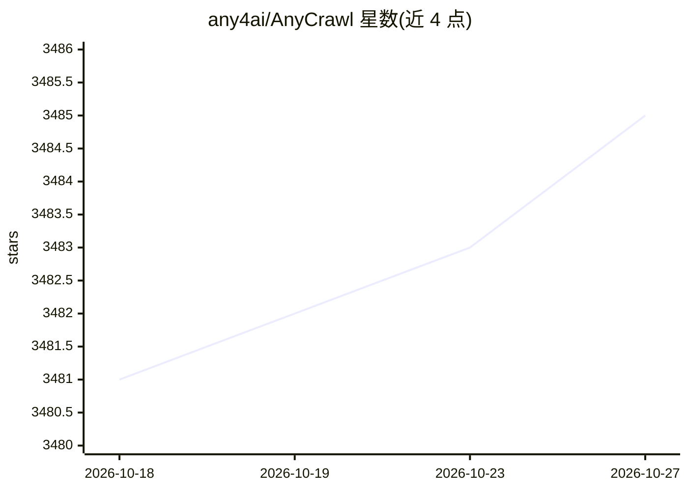

# any4ai/AnyCrawl

⭐ 3,485 · TypeScript · MIT · 推送 2026-09-29 · [GitHub](https://github.com/any4ai/AnyCrawl) · [官网](https://anycrawl.dev) · 组织维护

**面向 LLM 数据准备的网页抓取与 SERP 采集工具包**

Node.js/TypeScript 编写的抓取工具包，提供三类能力：单页抓取（cheerio/playwright/puppeteer 引擎、代理与缓存控制）、全站遍历爬取、Google 搜索结果（SERP）提取，并支持批量任务与多线程/多进程。可选的 LLM 提取功能通过 OpenAI 兼容的 Atlas Cloud 提供商从页面生成结构化 JSON。提供托管 API 与自托管两种方式，自托管基于 pnpm 与 Docker Compose，可启用 API key 认证与按量计费（credits）。浏览器引擎由 CloakBrowser 启动，要求 Node.js 20+。

## 筛选速览

| 维度 | 判定 | 备注 |
|---|---|---|
| AI 角色 | `ai-enhanced` | 去掉 AI 部分产品仍成立 |
| 许可风险 | `permissive` | MIT |
| 部署形态 | `self-host` | docker 或自建部署 |
| 模型依赖 | — | README 未给出锁定关系 |
| 硬件要求 | — | 无带数字的原话,不猜 |
| 安装摩擦 | `low` | 无编译、无系统依赖或容器化 |
| 成熟度 | — | 结构信号不足 |

## 能力要点

- cheerio/playwright/puppeteer 三种抓取引擎，支持 HTTP/SOCKS 代理
- 单页抓取、全站爬取、批量任务与 SERP 搜索四类 API 端点
- LLM 提取：通过 Atlas Cloud（OpenAI 兼容）生成页面结构化 JSON
- 自托管支持 Docker Compose、API key 认证与 credits 计费

## 适用场景

- 为 RAG 系统批量抓取并清洗网站内容
- 采集 Google 搜索结果做竞品或关键词研究
- 自托管一套带认证与计费的抓取 API 服务

## 场景标签

`网页抓取` · 领域:效率与自动化

## 证据(README 行号)

> L38: - **AI extraction**: LLM‑powered structured data (JSON) extraction from pages
> L130: AnyCrawl supports Atlas Cloud as an OpenAI-compatible LLM provider for extraction and summarization workloads.
> L244: We build simple, reliable, and scalable tools for the AI ecosystem.

## 星数曲线

2026-10-18 3,481 → 2026-10-27 3,485（+4）

---
*卡片 v1 · prompt 1.4 · 生成 2026-10-20 · 置信度 mid · 依据 README sha `2f42b5b898b2` · [字段定义](../../DATASET.md)*
