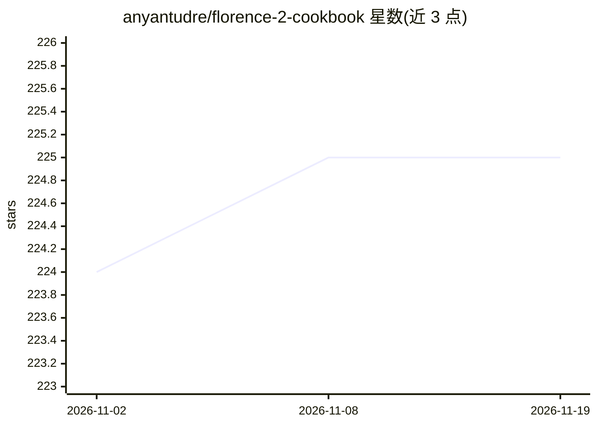

# anyantudre/florence-2-cookbook

⭐ 225 · Jupyter Notebook · MIT · 推送 2026-11-02 · [GitHub](https://github.com/anyantudre/florence-2-cookbook) · [官网](https://github.com/anyantudre/florence-2-cookbook/blob/main/AWESOME.md) · 个人维护

**Florence-2 视觉语言模型的非官方上手 notebook 集与指南**

围绕微软 Florence-2 视觉语言模型的社区教程仓库：提供 8 个 Colab notebook，覆盖 14 种内置任务的推理、图像自动标注并导出 YOLO 标注、DocVQA 全量微调与 LoRA 检测微调、多区域批量提问、框置信度评分、速度基准与问答评测，并附模型变体、任务提示词与架构说明。声明与微软无关联；推荐使用 transformers 原生支持的 florence-community 权重，原 microsoft 权重需 trust_remote_code 且在较新 transformers 上会报错。

## 筛选速览

| 维度 | 判定 | 备注 |
|---|---|---|
| AI 角色 | `ai-knowledge` | 知识聚合/清单类 |
| 许可风险 | `permissive` | MIT |
| 部署形态 | `None` |  |
| 模型依赖 | — | README 未给出锁定关系 |
| 硬件要求 | — | 无带数字的原话,不猜 |
| 安装摩擦 | `low` | 无编译、无系统依赖或容器化 |
| 成熟度 | — | 结构信号不足 |

## 能力要点

- 8 个 Colab notebook：推理、自动标注、微调、置信度评分、速度基准等
- 覆盖 Florence-2 的 14 种内置任务（描述、检测、分割、OCR、级联任务）
- 附模型变体表、任务提示词表与架构/训练数据说明

## 适用场景

- 学习并运行 Florence-2 的各类视觉任务推理
- 用 Florence-2 为图像文件夹自动生成检测标注
- 在自有数据上微调 Florence-2 并评测效果

## 场景标签

`教程课程` `微调` `目标检测` `OCR` · 领域:学习与行业

## 证据(README 行号)

> L10: Hands-on notebooks and a short guide to Florence-2, Microsoft's lightweight vision-language model: run inference on
> L27: |1|Sample inference|All 14 built-in tasks: captioning, detection, grounding, segmentation, OCR, cascaded tasks|Open

## 星数曲线

2026-11-02 224 → 2026-11-19 225（+1）

---
*卡片 v1 · prompt 1.4 · 生成 2026-11-17 · 置信度 high · 依据 README sha `34a792f736c5` · [字段定义](../../DATASET.md)*
