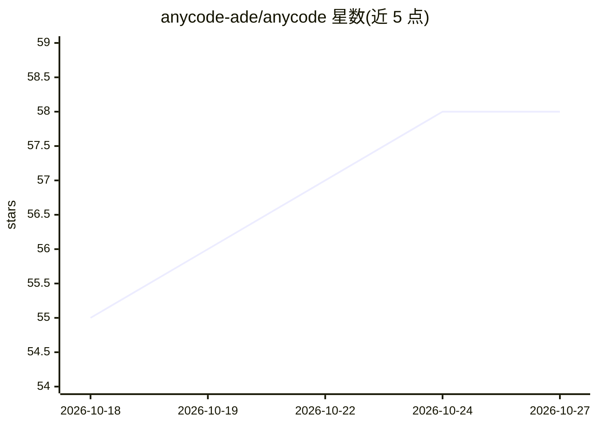

# anycode-ade/anycode

⭐ 58 · TypeScript · Apache-2.0 · 推送 2026-10-26 · [GitHub](https://github.com/anycode-ade/anycode) · [官网](https://anycode-ade.github.io/anycode/) · 组织维护

**人与 AI agent 协同编程的 Web 代码编辑器平台**

可在本地或远程运行、通过浏览器从桌面/笔记本/手机/VR 访问的代码编辑平台，本体为基于 tree-sitter 与 web-tree-sitter 的自研编辑器，提供 LSP 补全诊断、Git 变更面板与提交历史、WebSocket 文件系统集成、集成终端、搜索、Markdown/Mermaid 预览。AI 部分通过 Agent Client Protocol (ACP) 接入 Codex、Claude Code、OpenCode 及本地模型等 agent，支持工具调用流式输出、会话恢复、权限模式控制等。架构含 React 前端与 Rust 后端，提供 macOS/Linux/Windows 安装脚本，Apache-2.0 许可。

## 筛选速览

| 维度 | 判定 | 备注 |
|---|---|---|
| AI 角色 | `ai-enhanced` | 去掉 AI 部分产品仍成立 |
| 许可风险 | `permissive` | Apache-2.0 |
| 部署形态 | `desktop` | 安装包/桌面程序 |
| 模型依赖 | — | README 未给出锁定关系 |
| 硬件要求 | — | 无带数字的原话,不猜 |
| 安装摩擦 | `low` | 无编译、无系统依赖或容器化 |
| 成熟度 | — | 结构信号不足 |

## 能力要点

- 基于 tree-sitter/web-tree-sitter 的自研虚拟渲染编辑器
- ACP 协议接入 Codex/Claude Code/OpenCode 及本地模型等 agent，支持工具调用流式与历史回退撤销
- WebSocket 文件系统访问、Git 变更/历史、集成终端
- token 访问保护与远程托管模式

## 适用场景

- 在浏览器中从任意设备编辑本地或远程项目的代码
- 让 Codex/Claude Code 等 agent 在同一编辑器内协同修改代码
- 自托管一个带访问令牌保护的远程开发环境

## 场景标签

`编码 Agent` · 领域:编码与开发

## 证据(README 行号)

> L5: **anycode** is a web platform where people and agents build together. Run it locally or remotely and work from any d
> L23: - **ACP integration**: Agent Client Protocol (ACP) support for seamless integration with AI agents, including tool-

## 星数曲线

2026-10-18 55 → 2026-10-27 58（+3）

---
*卡片 v1 · prompt 1.4 · 生成 2026-10-24 · 置信度 mid · 依据 README sha `69be5a0efbc8` · [字段定义](../../DATASET.md)*
