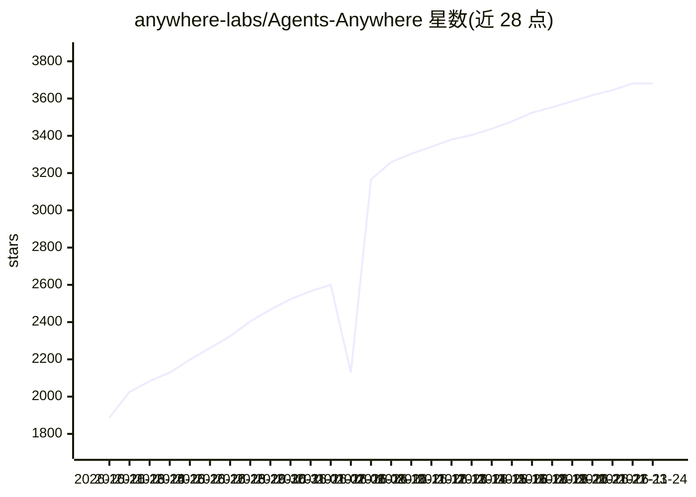

# anywhere-labs/Agents-Anywhere

⭐ 3,681 · Python · Apache-2.0 · 推送 2026-11-22 · [GitHub](https://github.com/anywhere-labs/Agents-Anywhere) · [官网](https://agents-anywhere.com) · 组织维护 · 中文 README

**在手机/桌面/Web 远程管理 coding agent 的开源工作台**

跨设备的开源 Agent 工作台：在工作设备上运行 Codex、Claude Code 或 DeepSeek Harness，通过桌面客户端、iOS/Android 应用或 Web 查看会话、回复工具审批与输入请求、管理文件与终端。Agent 实际在连接的工作设备上执行，手机等客户端只做控制。提供 Cloud 与 Docker 自托管两种服务形态（Compose 含 PostgreSQL、Redis、迁移任务与托管 Web 的 Server），Linux/headless 环境用 Connector CLI 接入，模型账号与费用遵循所用 Agent 的规则。

## 筛选速览

| 维度 | 判定 | 备注 |
|---|---|---|
| AI 角色 | `ai-ecosystem` | LLM/agent 周边工具 |
| 许可风险 | `permissive` | Apache-2.0 |
| 部署形态 | `self-host` | docker 或自建部署 |
| 模型依赖 | locked-api |  |
| 硬件要求 | — | 无带数字的原话,不猜 |
| 安装摩擦 | `low` | 无编译、无系统依赖或容器化 |
| 成熟度 | — | 结构信号不足 |

## 能力要点

- 支持 Codex、Claude Code 与 DeepSeek Harness 三种 Agent Runtime
- 桌面（macOS/Windows/Linux）、iOS/Android、Web 多端访问同一账号的设备与会话
- Docker Compose 自托管服务端（含 PostgreSQL、Redis）
- Connector RPC 架构：客户端控制、工作设备执行

## 适用场景

- 外出时用手机查看和回复工作电脑上 Agent 的任务请求
- 团队在自己服务器上自托管 Agent 会话管理服务
- headless 服务器通过 Connector CLI 接入统一管理

## 场景标签

`编码 Agent` · 领域:编码与开发

## 证据(README 行号)

> L16: **Agents Anywhere** 是跨设备的开源 Agent 工作台。连接运行 **Codex、Claude Code 或 DeepSeek Harness** 的工作设备，在桌面、手机和 Web 查看会话、回复请求、管理文
> L67: Runtime 是工作设备上运行和连接 Agent 的组件。模型账号和调用费用遵循所使用 Agent 的规则。各 Runtime 的能力存在差异，具体操作以客户端显示为准。DSH 接入说明 →

## 星数曲线

2026-10-21 1,887 → 2026-11-24 3,681（+1,794）

---
*卡片 v1 · prompt 1.4 · 生成 2026-11-23 · 置信度 high · 依据 README sha `92c947c4722a` · [字段定义](../../DATASET.md)*
