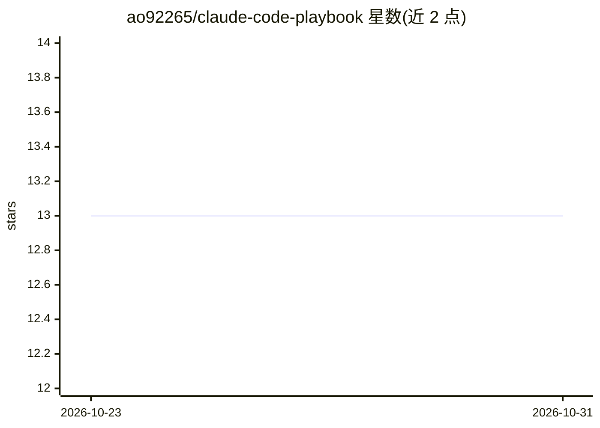

# ao92265/claude-code-playbook

⭐ 13 · JavaScript · MIT · 推送 2026-10-20 · [GitHub](https://github.com/ao92265/claude-code-playbook) · 个人维护

**面向开发者的 Claude Code 实战手册：技能、钩子与模板合集**

从 900+ 次生产环境 TypeScript 会话中整理的 Claude Code 使用模式合集，包含 76 篇指南文档、52 个即用型斜杠命令技能（环境检查、TDD、安全扫描、调试等）、28 个守护型钩子脚本、11 个技术栈专属 CLAUDE.md 模板及 5 个示例会话。提供一行脚本安装器，可按技术栈选择模板，或手动复制文件；另含 Python CLI 工具（缓存雷达、成本账本）。供希望在项目中规范使用 Claude Code 的开发者与团队使用。

## 筛选速览

| 维度 | 判定 | 备注 |
|---|---|---|
| AI 角色 | `ai-knowledge` | 知识聚合/清单类 |
| 许可风险 | `permissive` | MIT |
| 部署形态 | `None` |  |
| 模型依赖 | — | README 未给出锁定关系 |
| 硬件要求 | — | 无带数字的原话,不猜 |
| 安装摩擦 | `low` | 无编译、无系统依赖或容器化 |
| 成熟度 | — | 结构信号不足 |

## 能力要点

- 52 个即用型自定义斜杠命令技能
- 28 个守护型钩子脚本（提交/构建/密钥/会话状态检查）
- 11 个技术栈专属 CLAUDE.md 模板 + 团队入职模板
- 一行 curl 脚本安装器，支持按技术栈选择

## 适用场景

- 为项目配置 Claude Code 的规则、技能与钩子
- 团队按结构化流程入职使用 Claude Code
- 查阅提示工程模式与反模式规避常见问题

## 场景标签

`提示工程` `精选清单` · 领域:Agent 开发

## 证据(README 行号)

> L11: *Battle-tested patterns from 900+ sessions across production TypeScript projects.*
> L40: **Learn**
> L48: - 76 production-ready skills (custom `/commands`) you can drop into any project

## 星数曲线

2026-10-23 13 → 2026-10-31 13（+0）

---
*卡片 v1 · prompt 1.4 · 生成 2026-10-31 · 置信度 mid · 依据 README sha `2bc282b495d2` · [字段定义](../../DATASET.md)*
