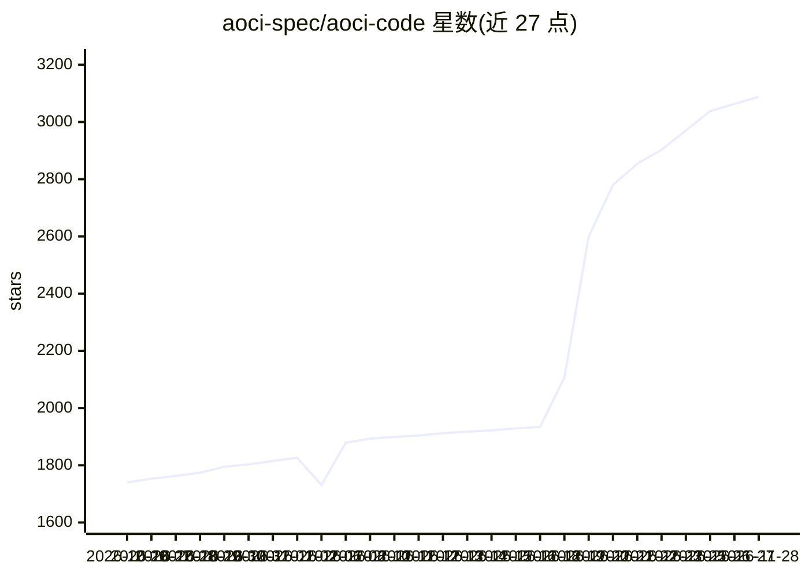

# aoci-spec/aoci-code

⭐ 3,088 · Go · NOASSERTION · 推送 2026-11-27 · [GitHub](https://github.com/aoci-spec/aoci-code) · [官网](www.aoci.ai) · 组织维护

**为编码代理提供 Git 版本化的代码库与数据库结构长期索引**

以 Go 实现的本地 MCP 服务器与 CLI，在项目目录内维护一组由代理编写、Git 版本管理的纯文本索引文件（aoci.txt/aoci.code.txt 等），每文件一条记录其职责、关联文件、公共契约与约束，代理在执行任务前一次性读取以获得系统全貌；MCP 服务器检测代码变更并发出待更新条目，代理在任务完成后增量维护索引。支持为 MySQL 5.7.6+、PostgreSQL、openGauss 6.0.5 及带约束的 SQLite 建表级索引。仅本地读写、不联网、不存储数据库凭据。通过 GitHub Releases 签名包或源码构建安装，需支持 stdio MCP 的宿主。

## 筛选速览

| 维度 | 判定 | 备注 |
|---|---|---|
| AI 角色 | `ai-ecosystem` | LLM/agent 周边工具 |
| 许可风险 | `none` | NOASSERTION |
| 部署形态 | `desktop` | 安装包/桌面程序 |
| 模型依赖 | — | README 未给出锁定关系 |
| 硬件要求 | — | 无带数字的原话,不猜 |
| 安装摩擦 | `low` | 无编译、无系统依赖或容器化 |
| 成熟度 | `idea` | |

## 能力要点

- 每文件一行的 FRAS 索引格式：职责/必读关联/依赖契约/不可违背约束
- 索引存于项目内并由 Git 版本化，跨代理、跨会话可复用
- MCP 服务器检测代码变更并驱动代理增量维护索引
- 支持代码与数据库表级联合索引（MySQL/PostgreSQL/openGauss/SQLite）

## 适用场景

- 让编码代理在接手大型既有代码库前先建立系统级认知
- 项目换人、换代理或新开会话时通过读取索引恢复上下文
- 非专业开发者自行迭代个人系统时代理已了解全貌
- 同时向代理提供代码与数据库结构的联合知识

## 场景标签

`Agent 记忆` · 领域:Agent 开发

## 证据(README 行号)

> L89: **AOCI (AI-Oriented Cognition Infrastructure)** is the method and protocol: a layer between coding agents and softw
> L91: AOCI-CODE distills what actually matters for understanding and changing a system into a dense, plain-text index tha
> L126: AOCI-CODE integrates with the MCP host, not with a model-provider API. DeepSeek

## 星数曲线

2026-10-26 1,740 → 2026-11-28 3,088（+1,348）

---
*卡片 v1 · prompt 1.4 · 生成 2026-11-28 · 置信度 mid · 依据 README sha `89643d196ae0` · [字段定义](../../DATASET.md)*
