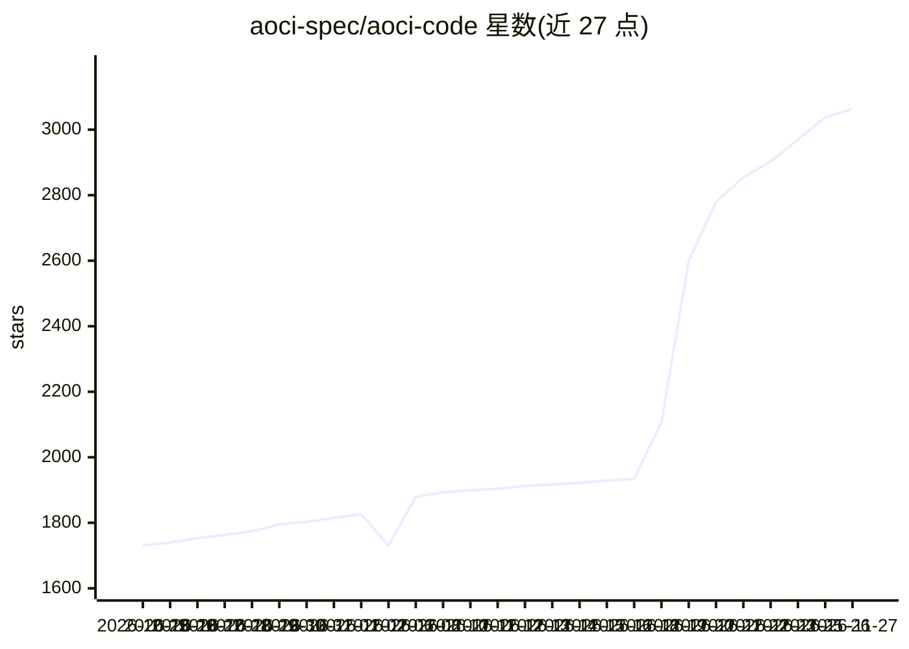

# aoci-spec/aoci-code

⭐ 3,063 · Go · NOASSERTION · 推送 2026-11-26 · [GitHub](https://github.com/aoci-spec/aoci-code) · [官网](www.aoci.ai) · 组织维护 · 中文 README

**给编码代理提供 Git 版本化代码库认知索引的本地 MCP 服务**

Go 编写的本地 MCP 服务器与 CLI，为 Codex、Claude Code、Cursor、OpenCode 等编码代理维护一份持久的、Git 版本化的代码库索引（每文件一行，含职责 F、关联 R、契约 A、不可破坏约束 S），代理在执行任务前先读索引以了解整个系统；MCP 服务器检测代码变更并提示代理更新条目，使索引与代码保持同步。另可为 MySQL/PostgreSQL/openGauss 6.0.5 建表级数据库索引。仅本地运行：只读系统、不联网、不存储凭据。通过 Release 包或源码构建分发。

## 筛选速览

| 维度 | 判定 | 备注 |
|---|---|---|
| AI 角色 | `ai-ecosystem` | LLM/agent 周边工具 |
| 许可风险 | `none` | NOASSERTION |
| 部署形态 | `desktop` | 安装包/桌面程序 |
| 模型依赖 | — | README 未给出锁定关系 |
| 硬件要求 | — | 无带数字的原话,不猜 |
| 安装摩擦 | `low` | 无编译、无系统依赖或容器化 |
| 成熟度 | — | 结构信号不足 |

## 能力要点

- 每文件一行的纯文本索引（F/R/A/S 字段 + 层级标签），存于仓库内由 Git 版本化
- MCP 服务器检测变更并触发代理增量维护索引
- 支持 MySQL 5.7.6+、PostgreSQL、openGauss 6.0.5 的表级索引
- 本地优先：只读、不联网、数据库凭据仅以环境变量名引用

## 适用场景

- 让代理在大型代码库（约 50 万行级别）上接手开发而不每次重读代码
- 项目换人、换代理或开新会话时通过读索引延续上下文
- 让代理同时理解代码与数据库表结构后再动手

## 场景标签

`Agent 记忆` · 领域:Agent 开发

## 证据(README 行号)

> L5: **A persistent, Git-versioned map of your entire codebase — written by your coding agent, governed by a local MCP se
> L89: **AOCI (AI-Oriented Cognition Infrastructure)** is the method and protocol: a layer between coding agents and softw
> L91: AOCI-CODE distills what actually matters for understanding and changing a system into a dense, plain-text index tha

## 星数曲线

2026-10-25 1,731 → 2026-11-27 3,063（+1,332）

---
*卡片 v1 · prompt 1.4 · 生成 2026-11-24 · 置信度 high · 依据 README sha `84c8b11c2a8a` · [字段定义](../../DATASET.md)*
