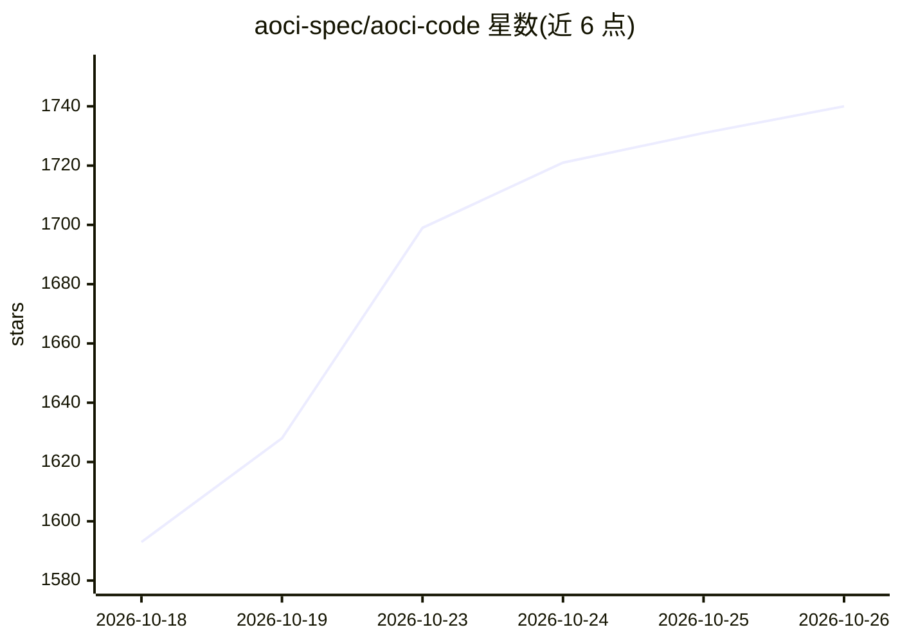

# aoci-spec/aoci-code

⭐ 1,740 · Go · NOASSERTION · 推送 2026-10-25 · [GitHub](https://github.com/aoci-spec/aoci-code) · [官网](www.aoci.ai) · 组织维护 · 中文 README

**为编码 agent 提供代码库持久索引的本地 MCP 服务器与 CLI**

用 Go 编写的本地优先工具：让编码 agent 为整个代码库及数据库表结构（MySQL/PostgreSQL/受限 openGauss）逐文件撰写一行式索引（职责、依赖、契约、约束），以纯文本形式存于仓库内并由 Git 版本化；MCP 服务器检测代码变更并驱动增量维护，使 Codex、Claude Code、Cursor、OpenCode 等 MCP 宿主在任务开始前一次性读取索引获得系统级上下文。本地运行、不访问互联网、不存储数据库凭证；首次建索引约每 20 万行代码耗时 1 小时；当前为 v0.1.0-rc21 发布候选，FSL-1.1-MIT 许可，提供签名二进制或源码构建。

## 筛选速览

| 维度 | 判定 | 备注 |
|---|---|---|
| AI 角色 | `ai-ecosystem` | LLM/agent 周边工具 |
| 许可风险 | `none` | NOASSERTION |
| 部署形态 | `desktop` | 安装包/桌面程序 |
| 模型依赖 | — | README 未给出锁定关系 |
| 硬件要求 | — | 无带数字的原话,不猜 |
| 安装摩擦 | `low` | 无编译、无系统依赖或容器化 |
| 成熟度 | `idea` | |

## 能力要点

- 模型逐文件撰写的一行式索引（F/R/A/S 四字段 + 层级标签）
- 索引随代码存于仓库、由 Git 版本化，跨 agent 与会话可复用
- MCP 服务器检测代码变更并增量维护索引
- 支持 MySQL/PostgreSQL 表结构索引，本地运行、不联网、不存凭证

## 适用场景

- 让编码 agent 接手既有大型代码库前建立整体认知
- 项目换人、换 agent 或开新会话时保留系统级上下文
- 代码与数据库表结构联合索引，辅助 agent 理解全系统

## 场景标签

`Agent 记忆` · 领域:Agent 开发

## 证据(README 行号)

> L87: **AOCI (AI-Oriented Cognition Infrastructure)** is the method and protocol: a layer between coding agents and softw
> L5: **A persistent, Git-versioned map of your entire codebase — written by your coding agent, governed by a local MCP se
> L113: Get AOCI-CODE from the canonical source or use a signed package from GitHub Releases. Before using a prebuilt bina

## 星数曲线

2026-10-18 1,593 → 2026-10-26 1,740（+147）

---
*卡片 v1 · prompt 1.4 · 生成 2026-10-21 · 置信度 high · 依据 README sha `4a2937235402` · [字段定义](../../DATASET.md)*
