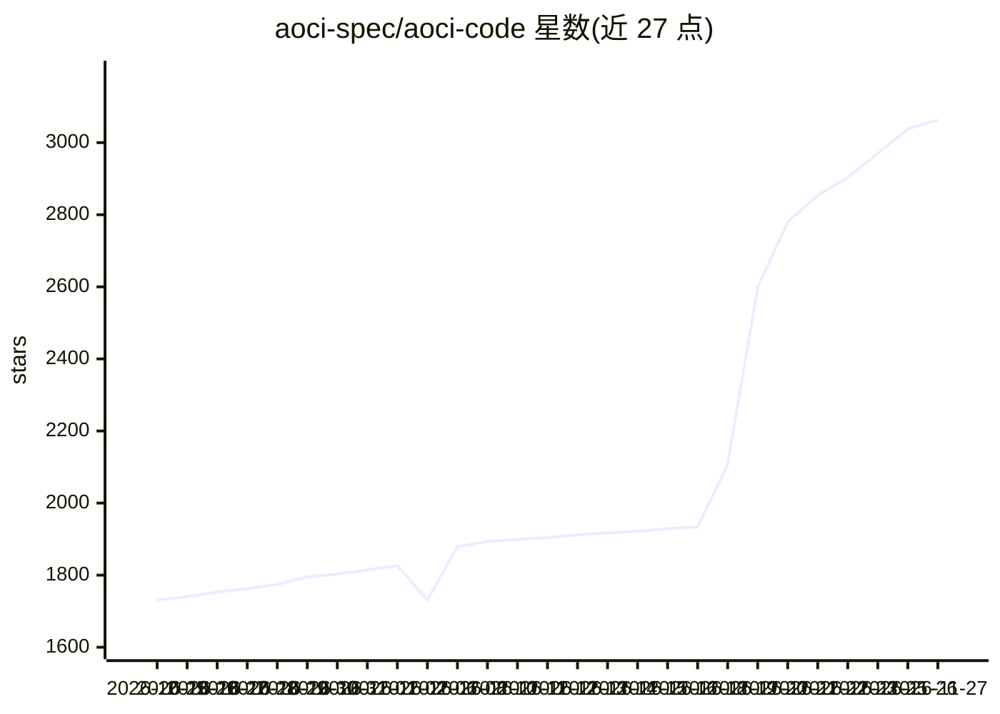

# aoci-spec/aoci-code

⭐ 3,063 · Go · NOASSERTION · 推送 2026-11-26 · [GitHub](https://github.com/aoci-spec/aoci-code) · [官网](www.aoci.ai) · 组织维护 · 中文 README

**给编码 agent 提供持久化、Git 版本化的代码库与数据库索引**

用 Go 编写的本地 MCP 服务器与 CLI：由编码 agent 为代码库每个文件与数据库表撰写单行索引条目（职责 F、关联 R、契约 A、约束 S），存于仓库内并随 Git 版本化。agent 在任务开始前读取索引即可掌握整个系统，减少重复搜索与重读；MCP 服务器检测代码变更并下发需更新的条目，使索引随开发自动保持一致。支持 MySQL 5.7.6+/PostgreSQL，及带约束的 openGauss 6.0.5 与 SQLite；仅本地运行、只读源码与表结构、不联网。通过二进制签名包或源码构建安装，v0.2.0-rc5 采用 FSL-1.1-MIT。

## 筛选速览

| 维度 | 判定 | 备注 |
|---|---|---|
| AI 角色 | `ai-ecosystem` | LLM/agent 周边工具 |
| 许可风险 | `none` | NOASSERTION |
| 部署形态 | `desktop` | 安装包/桌面程序 |
| 模型依赖 | — | README 未给出锁定关系 |
| 硬件要求 | — | 无带数字的原话,不猜 |
| 安装摩擦 | `low` | 无编译、无系统依赖或容器化 |
| 成熟度 | — | 结构信号不足 |

## 能力要点

- 每文件一行的 FRAS 索引条目，agent 一次读取覆盖全系统
- 索引存于仓库并由 Git 版本化，跨人员、agent、会话延续
- MCP 检测变更并下发条目更新，索引自动与代码对齐
- 代码与数据库表级索引（MySQL/PostgreSQL/openGauss/SQLite）

## 适用场景

- 让编码 agent 接手约 50 万行的既有系统并继续开发
- 在多会话/多人/多 agent 交接时不丢失对系统的理解
- 为 agent 同时提供代码与数据库结构的整体认知

## 场景标签

`Agent 记忆` · 领域:Agent 开发

## 证据(README 行号)

> L5: **A persistent, Git-versioned map of your entire codebase — written by your coding agent, governed by a local MCP se
> L89: **AOCI (AI-Oriented Cognition Infrastructure)** is the method and protocol: a layer between coding agents and softw
> L126: AOCI-CODE integrates with the MCP host, not with a model-provider API. DeepSeek

## 星数曲线

2026-10-25 1,731 → 2026-11-27 3,063（+1,332）

---
*卡片 v1 · prompt 1.4 · 生成 2026-11-27 · 置信度 high · 依据 README sha `d37645fc833c` · [字段定义](../../DATASET.md)*
