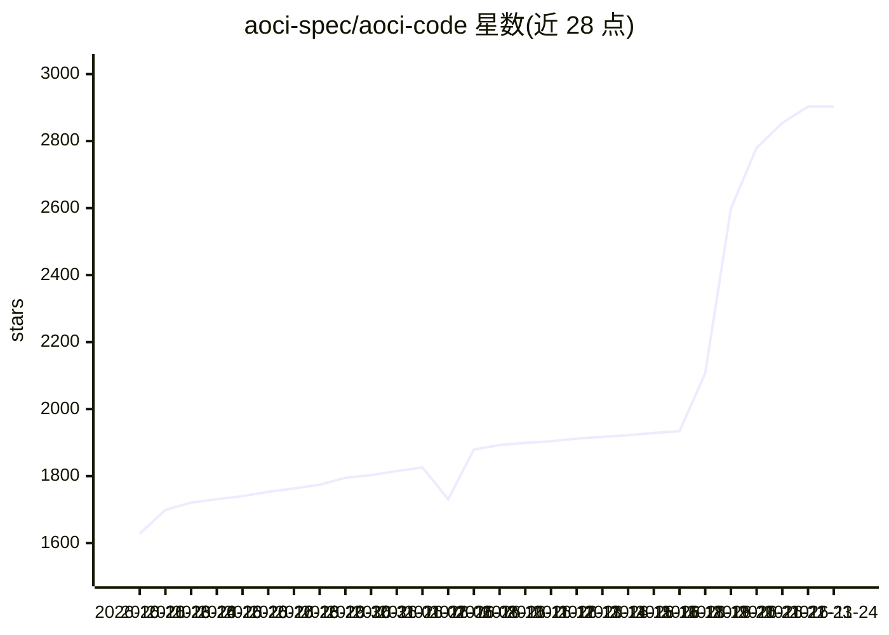

# aoci-spec/aoci-code

⭐ 2,903 · Go · NOASSERTION · 推送 2026-11-21 · [GitHub](https://github.com/aoci-spec/aoci-code) · [官网](www.aoci.ai) · 组织维护 · 中文 README

**为编码 agent 提供代码库与数据库结构的持久化索引**

以 Go 编写的本地 MCP 服务器与 CLI，为代码库生成 Git 版本化、按文件一行的纯文本索引（职责、依赖、公开接口、不可破坏约束），agent 在执行任务前先读索引以减少反复检索。索引存于项目仓库内可 diff 与回滚，MCP 服务器检测代码变更并驱动增量维护。支持对 MySQL 5.7.6+/PostgreSQL 及受约束的 openGauss 6.0.5 建表级索引。仅本地运行、只读源码与表结构，不联网。首次建索引约每 20 万行耗时一小时。当前版本 v0.2.0-rc3，FSL-1.1-MIT 许可。

## 筛选速览

| 维度 | 判定 | 备注 |
|---|---|---|
| AI 角色 | `ai-ecosystem` | LLM/agent 周边工具 |
| 许可风险 | `none` | NOASSERTION |
| 部署形态 | `desktop` | 安装包/桌面程序 |
| 模型依赖 | — | README 未给出锁定关系 |
| 硬件要求 | — | 无带数字的原话,不猜 |
| 安装摩擦 | `low` | 无编译、无系统依赖或容器化 |
| 成熟度 | — | 结构信号不足 |

## 能力要点

- 每文件一行的 FRAS 索引格式，带层级/领域/重要度标签
- 索引随代码存于 Git，可 diff、版本化与回滚
- MCP 服务器检测变更并驱动增量维护
- 支持 MySQL/PostgreSQL/openGauss 的表级数据库索引

## 适用场景

- 让 agent 接手既有大型代码库而无需每次重新通读
- 项目换人、换 agent 或新开会话时通过索引恢复上下文
- 让非专业开发者持续迭代自己的系统

## 场景标签

`编码 Agent` · 领域:编码与开发

## 证据(README 行号)

> L89: **AOCI (AI-Oriented Cognition Infrastructure)** is the method and protocol: a layer between coding agents and softw
> L5: **A persistent, Git-versioned map of your entire codebase — written by your coding agent, governed by a local MCP se

## 星数曲线

2026-10-21 1,628 → 2026-11-24 2,903（+1,275）

---
*卡片 v1 · prompt 1.4 · 生成 2026-11-23 · 置信度 high · 依据 README sha `8541ee4387b5` · [字段定义](../../DATASET.md)*
