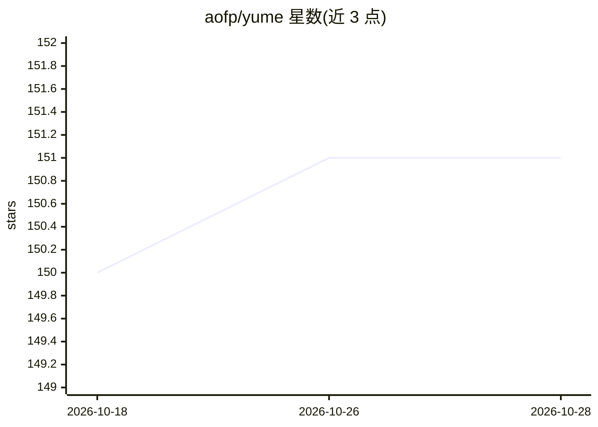

# aofp/yume

⭐ 151 · HTML · NOASSERTION · 推送 2026-10-20 · [GitHub](https://github.com/aofp/yume) · [官网](https://aofp.github.io/yume/) · 个人维护

**Claude Code 的原生桌面 GUI，含编排流程与多后端模型**

基于 Tauri + React 构建的 Claude Code 桌面前端：以子进程方式运行官方 claude CLI 二进制，复用用户现有 Claude 订阅与认证，不直接调用 Anthropic API。提供编排流程（理解→分解→执行→验证）、4 个内置前台 agent、4 个并发后台 agent（git worktree 隔离、30 分钟超时）、插件/skills/hooks 系统、多 provider 接入（claude/gemini/openai/kiro 经 yume-cli shim）、可视化 diff 与回滚、限流常驻显示、语音听写与 vim 模式。需本机已安装 Claude Code CLI 及 Claude 账户；免费版限制 2 标签页，Pro 为付费升级。

## 筛选速览

| 维度 | 判定 | 备注 |
|---|---|---|
| AI 角色 | `ai-ecosystem` | LLM/agent 周边工具 |
| 许可风险 | `none` | NOASSERTION |
| 部署形态 | `None` |  |
| 模型依赖 | — | README 未给出锁定关系 |
| 硬件要求 | — | 无带数字的原话,不猜 |
| 安装摩擦 | `low` | 无编译、无系统依赖或容器化 |
| 成熟度 | — | 结构信号不足 |

## 能力要点

- 以子进程运行官方 Claude Code CLI，保持 100% CLI 兼容（subagents/MCP/hooks/skills）
- 4 内置 agent + 4 并发后台 agent（worktree 隔离、合并冲突检测）
- 多 provider 支持：claude/gemini/openai/kiro，15+ 模型，统一 stream-json 接口
- 编排流程内置于每个会话：理解→分解→执行→验证

## 适用场景

- 在原生桌面应用中运行 Claude Code，替代终端界面
- 并行运行多个会话与后台 agent 处理多任务
- 跨模型切换（claude/gemini/openai/kiro）而不改变工作流
- 常驻查看 5 小时/7 天用量限额避免超额计费

## 场景标签

`编码 Agent` · 领域:编码与开发

## 证据(README 行号)

> L31: yume is **not** an alternate harness or api wrapper. we spawn the **official claude code cli** as a subprocess.
> L34: yume app → spawns real cli binary → cli handles auth → anthropic servers
> L67: - **15+ models, 4 providers** - non-claude providers via yume-cli shim

## 星数曲线

2026-10-18 150 → 2026-10-28 151（+1）

---
*卡片 v1 · prompt 1.4 · 生成 2026-10-22 · 置信度 high · 依据 README sha `f42305d1e4dc` · [字段定义](../../DATASET.md)*
