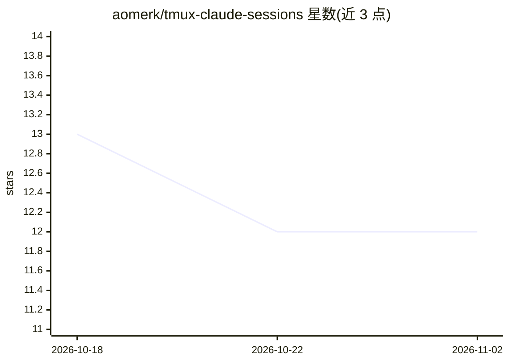

# aomerk/tmux-claude-sessions

⭐ 12 · Python · MIT · 推送 2026-02-22 · [GitHub](https://github.com/aomerk/tmux-claude-sessions) · 个人维护

**在 tmux 中浏览并恢复 Claude AI 会话的插件**

TPM 兼容的 tmux 插件，通过一键（Prefix + g）弹出浮窗列出所有 Claude AI 对话，按项目分组并在右侧实时预览；选中后在新 tmux 窗口中运行 claude -r 恢复会话，若该会话已打开则跳转到对应窗口。picker.py 解析 Claude CLI 在 ~/.claude/projects/ 下的目录编码方案还原项目路径，preview.py 渲染对话，支持 fzf 模糊搜索与 vim 风格键位。要求 tmux ≥ 3.2、Python 3、fzf 与 PATH 中的 claude CLI。

## 筛选速览

| 维度 | 判定 | 备注 |
|---|---|---|
| AI 角色 | `ai-ecosystem` | LLM/agent 周边工具 |
| 许可风险 | `permissive` | MIT |
| 部署形态 | `None` |  |
| 模型依赖 | locked-api |  |
| 硬件要求 | — | 无带数字的原话,不猜 |
| 安装摩擦 | `low` | 无编译、无系统依赖或容器化 |
| 成熟度 | — | 结构信号不足 |

## 能力要点

- 一键弹出浮窗，列出按项目分组的全部 Claude 会话并实时预览
- 恢复会话运行 claude -r，已打开会话自动跳转去重
- fzf 模糊搜索过滤会话与项目
- 键位、浮窗尺寸、项目目录均可配置

## 适用场景

- 在 tmux 中快速找回并继续之前的 Claude 对话
- 多项目并行时按项目分组管理 Claude 会话
- 浏览历史会话内容后再决定恢复哪一个

## 场景标签

 · 领域:开发工具/终端

## 证据(README 行号)

> L3: > Browse and resume all your Claude AI conversations directly from tmux
> L102: `claude -r <session-id>` in a new tmux window, or switches to the

## 星数曲线

2026-10-18 13 → 2026-11-02 12（-1）

---
*卡片 v1 · prompt 1.4 · 生成 2026-11-01 · 置信度 high · 依据 README sha `e76e145ea561` · [字段定义](../../DATASET.md)*
