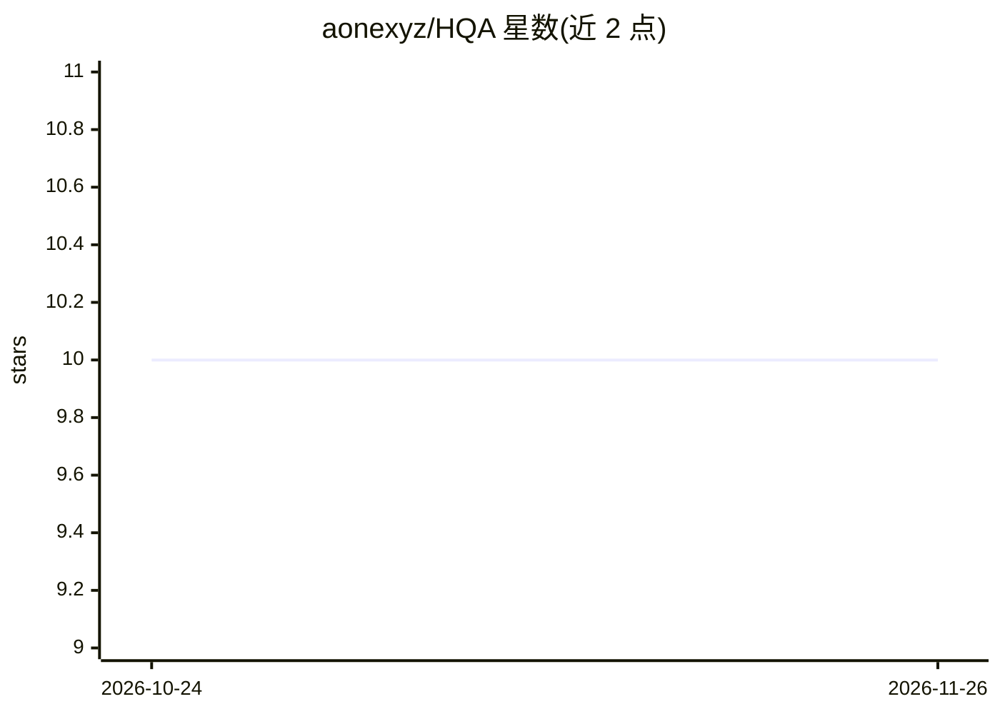

# aonexyz/HQA

⭐ 10 · Python · MIT · 推送 2026-01-02 · [GitHub](https://github.com/aonexyz/HQA) · 个人维护

**用 LLM 批量重构代码库提升整洁度的命令行工具**

一个命令行工具，遍历指定目录中指定扩展名的文件，先创建顺序备份文件夹，再通过 LLM 按 HQA 代码质量标准（去重、有效注释、符合语言惯例等）改写代码，支持 -lvl 0-4 五档文档级别和 --doc 仅生成文档模式。默认通过 Ollama 本地调用 llama3.1，可经 --model/--base_url/--api_key 切换任意 OpenAI 兼容服务。README 提示输出不一定是有效代码，需在 IDE 中检查。

## 筛选速览

| 维度 | 判定 | 备注 |
|---|---|---|
| AI 角色 | `ai-ecosystem` | LLM/agent 周边工具 |
| 许可风险 | `permissive` | MIT |
| 部署形态 | `library` | 以包/库形式分发 |
| 模型依赖 | local-ok | 支持本地模型 |
| 硬件要求 | — | 无带数字的原话,不猜 |
| 安装摩擦 | `low` | 无编译、无系统依赖或容器化 |
| 成熟度 | — | 结构信号不足 |

## 能力要点

- 处理目录前自动创建顺序备份，支持 --single-backup
- 默认本地 Ollama + llama3.1，兼容任意 OpenAI 兼容服务器
- 0-4 五档文档生成级别，--doc 可仅生成文档
- OpenAI Python SDK 发送 prompt，rich 输出进度条

## 适用场景

- 批量清理项目中的冗余重复代码
- 为现有代码库按需补充或精简文档
- 本地离线环境下用 LLM 重构代码

## 场景标签

 · 领域:开发者工具/代码质量

## 证据(README 行号)

> L3: H Q A is a command line tool to level up codebases to `HQA` (high quality using AI) (local by default). It processes
> L33: by default it assumes you have an Ollama server, with the model of `llama3.1`.

## 星数曲线

2026-10-24 10 → 2026-11-26 10（+0）

---
*卡片 v1 · prompt 1.4 · 生成 2026-11-20 · 置信度 mid · 依据 README sha `f8d9a41a7366` · [字段定义](../../DATASET.md)*
