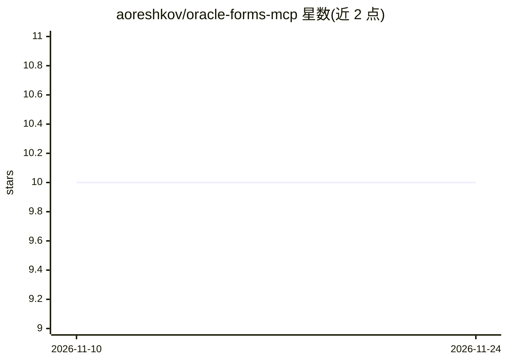

# aoreshkov/oracle-forms-mcp

⭐ 10 · Kotlin · Apache-2.0 · 推送 2026-11-22 · [GitHub](https://github.com/aoreshkov/oracle-forms-mcp) · [官网](https://registry.modelcontextprotocol.io/) · 个人维护

**把 Oracle Forms 模块内容暴露给 AI 助手的 MCP 服务器**

MCP 服务器，扫描目录中的 Oracle Forms 二进制模块（.fmb/.mmb/.pll/.olb），经 Oracle 工具或预转换 XML 生成结构化索引，向 AI 助手提供 17 个工具：列出/抓取模块、读取块与触发器 PL/SQL、跨模块全文检索、记录注释与元素关联，并有资源模板与 explain_module 提示。基于 Kotlin Multiplatform 核心，支持 stdio 与 HTTP 传输，带指纹磁盘缓存；无 ORACLE_HOME 时可读预转换文件，也可自定义转换命令。无遥测、本地运行。

## 筛选速览

| 维度 | 判定 | 备注 |
|---|---|---|
| AI 角色 | `ai-ecosystem` | LLM/agent 周边工具 |
| 许可风险 | `permissive` | Apache-2.0 |
| 部署形态 | `None` |  |
| 模型依赖 | locked-api |  |
| 硬件要求 | — | 无带数字的原话,不猜 |
| 安装摩擦 | `medium` | 含编译或系统依赖之一 |
| 成熟度 | — | 结构信号不足 |

## 能力要点

- 17 个 MCP 工具覆盖模块枚举、块/触发器/程序单元读取与跨模块检索
- annotate_element/relate_elements 跨会话持久化注释与交叉引用
- stdio 与 HTTP 两种传输，指纹缓存支持 STALE 重取
- 提供 Claude Code 插件、.mcpb 桌面包、Docker 与源码构建四种分发方式

## 适用场景

- 让 AI 助手解读无法用 Forms Builder 打开的遗留 .fmb 模块
- 为 Forms 迁移到 APEX/Java 做代码审查与文档整理
- 在多个表单间追踪调用、GLOBAL 变量与子类化指针

## 场景标签

`代码审查` `文档解析` · 领域:编码与开发

## 证据(README 行号)

> L9: An MCP server that serves the content of Oracle Forms modules
> L11: directory, so AI assistants can inspect blocks, items, triggers, program units, and raw object
> L14: Built as a Kotlin Multiplatform core (pure `@Serializable` models and ports) with a JVM MCP

## 星数曲线

2026-11-10 10 → 2026-11-24 10（+0）

---
*卡片 v1 · prompt 1.4 · 生成 2026-11-20 · 置信度 high · 依据 README sha `22e551aa78ed` · [字段定义](../../DATASET.md)*
