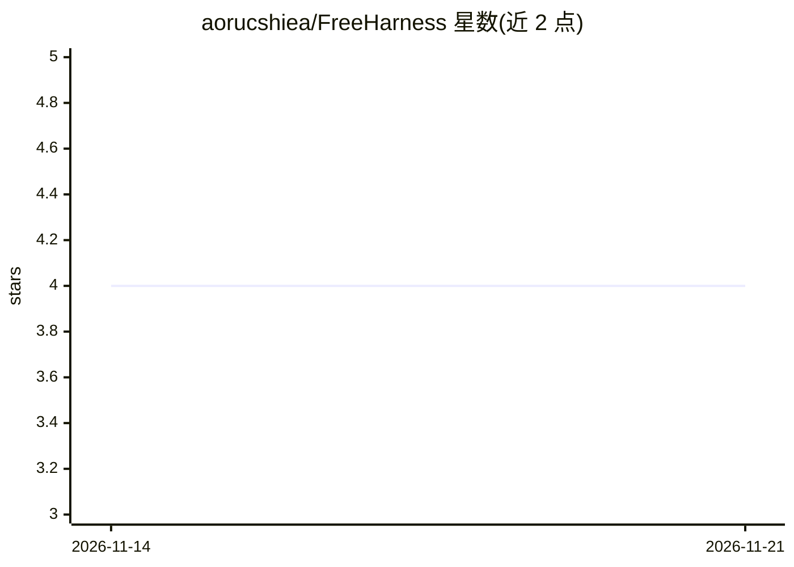

# aorucshiea/FreeHarness

⭐ — · [GitHub]() · 个人维护 · 中文 README

**让已登录的网页版 AI 直接操作本机的浏览器扩展+本地执行器**

由浏览器扩展与零依赖 Python 本地服务组成的工具：扩展监听网页版 AI（DeepSeek、智谱、ChatGPT、Claude 等）回复中的 [TOOL_CALL] 标记，本地服务执行对应工具（命令、文件读写、截图、鼠标键盘等 18 个），结果自动填回对话框循环执行。无需 API key，使用用户网页账号额度。按平台注入定制提示词，内置高危命令黑名单、127.0.0.1 监听、来源校验与暂停开关；README 自述网页 AI 改版、限流与长上下文受限是局限。

## 筛选速览

| 维度 | 判定 | 备注 |
|---|---|---|
| AI 角色 | `ai-native` | 本体是模型或模型工具 |
| 许可风险 | `permissive` | — |
| 部署形态 | `library` | 以包/库形式分发 |
| 模型依赖 | locked-api |  |
| 硬件要求 | — | 无带数字的原话,不猜 |
| 安装摩擦 | `low` | 无编译、无系统依赖或容器化 |
| 成熟度 | `idea` | |

## 能力要点

- 18 个本地工具：命令执行、文件读写、截图看图、鼠标键盘、窗口与剪贴板
- 按平台（Windows/macOS/Linux）定制提示词，只发送本平台说明
- 安全设计：127.0.0.1 监听、双重来源校验、高危命令黑名单、悬浮暂停按钮
- 支持 Native Messaging 自动拉起本地服务，DOM 适配器可自行扩展新站点

## 适用场景

- 不买 API、低成本体验 Agent 操作电脑
- 本机轻量自动化：整理文件、合并 txt、截图后打开应用
- 学习 harness / tool-calling 的实现原理

## 场景标签

`GUI 自动化` · 领域:效率与自动化

## 证据(README 行号)

> L7: 让你**已经登录的网页版 AI**（DeepSeek / 智谱 / 通义 / 元宝 / 豆包 / ChatGPT / Claude / Gemini / Kimi）能直接操作这台电脑：执行命令、读写文件、截图看图、点鼠标。
> L17: 网页 AI 本身只能在对话框里输出文字。FreeHarness 在中间加了一层"翻译"：
> L26: - **浏览器扩展**：识别网页里的 AI 回复，提取工具调用，把执行结果填回对话框

## 星数曲线

2026-11-14 4 → 2026-11-21 4（+0）

---
*卡片 v1 · prompt 1.4 · 生成 2026-11-21 · 置信度 mid · 依据 README sha `fcd930768e83` · [字段定义](../../DATASET.md)*
