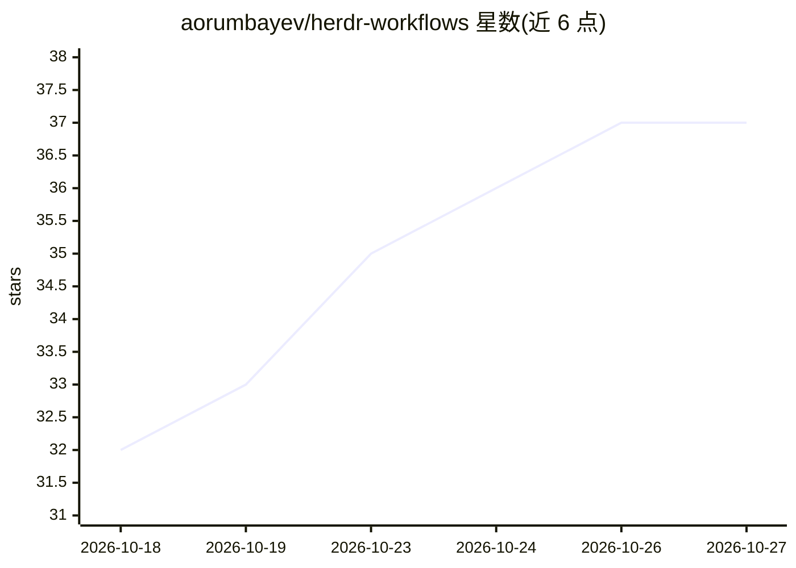

# aorumbayev/herdr-workflows

⭐ 37 · Go · MIT · 推送 2026-10-22 · [GitHub](https://github.com/aorumbayev/herdr-workflows) · [官网](https://aorumbayev.github.io/herdr-workflows/) · 个人维护

**herdr 插件：用 YAML 声明重复工作流并从热键启动**

herdr 终端复用器的插件，把日常重复操作序列写成简短 YAML 工作流，通过 prefix+k 热键或 CLI 启动。每步可执行四种动作：运行本地命令并捕获输出、启动编码 agent 并发送 prompt（如示例中让 Claude 审查 diff）、调用 herdr API、或运行子工作流。支持重试、断点续跑、后台 JSON 运行摘要与全屏控制台。无沙箱，工作流文件即代码，运行他人分享的工作流前需自行阅读。要求 herdr 0.8.2+，Linux/macOS 原生、Windows 需 WSL2。

## 筛选速览

| 维度 | 判定 | 备注 |
|---|---|---|
| AI 角色 | `ai-ecosystem` | LLM/agent 周边工具 |
| 许可风险 | `permissive` | MIT |
| 部署形态 | `None` |  |
| 模型依赖 | — | README 未给出锁定关系 |
| 硬件要求 | — | 无带数字的原话,不猜 |
| 安装摩擦 | `low` | 无编译、无系统依赖或容器化 |
| 成熟度 | — | 结构信号不足 |

## 能力要点

- 四类步骤：run/agent/herdr/workflow
- prefix+k 选择运行，Ctrl+P 动作面板
- hwf retry 支持 --from-failed 断点续跑
- hwf skills show 输出技能文本交给 agent 构建工作流

## 适用场景

- 把『跑测试→读 diff→让 agent 审查』的日常序列写成一条热键工作流
- 在脚本或 CI 中以 hwf run --detach --json 后台执行工作流
- 查看带图表的全屏控制台回顾运行历史

## 场景标签

`工作流自动化` · 领域:效率与自动化

## 证据(README 行号)

> L10: You retype the same sequence every day: run the tests, read the diff, ask an agent to review it. herdr-workflows is
> L15: |`agent:`|Starts a coding agent, sends a prompt, waits for it|

## 星数曲线

2026-10-18 32 → 2026-10-27 37（+5）

---
*卡片 v1 · prompt 1.4 · 生成 2026-10-25 · 置信度 high · 依据 README sha `7d687ffafe60` · [字段定义](../../DATASET.md)*
