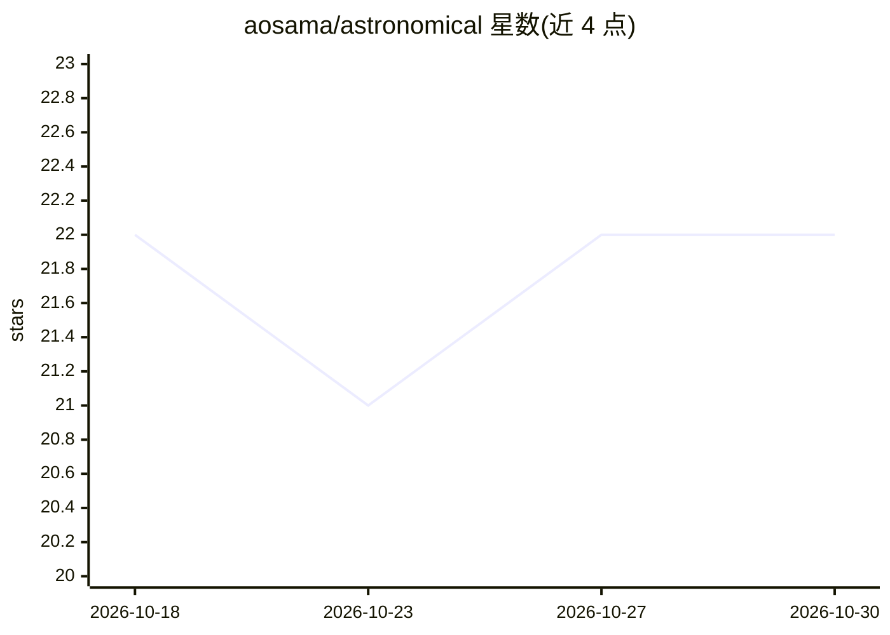

# aosama/astronomical

⭐ 22 · Rust · Apache-2.0 · 推送 2026-10-29 · [GitHub](https://github.com/aosama/astronomical) · [官网](https://aosama.github.io/astronomical/) · 个人维护

**Apple Silicon 本地模型运行器：设定 RAM 上限、SSD 流式运行稀疏大模型**

面向 Apple Silicon Mac 用户本地运行语言与视觉模型。核心机制是用户设定单一模型内存上限，运行器在其内自动平衡常驻专家权重、活跃上下文、运行时开销与 SSD 按需流式分页；模型可整体驻留时保持常驻，内存不足时切换为 RAM+SSD 流式，不做隐藏量化。服务路径用 Rust/C++ 实现并经 Apple MLX 执行，提供 OpenAI 兼容的 loopback API 与本地可视化监控。限制：实验性项目，单用户单并发，仅验证 Qwen3.5/3.6、Laguna、FLUX.2 Klein、ModernBERT 等模型；需从源码构建，依赖 Xcode/macOS 26 SDK、CMake、Rust nightly、Swift 6.2 等工具链。

## 筛选速览

| 维度 | 判定 | 备注 |
|---|---|---|
| AI 角色 | `ai-ecosystem` | LLM/agent 周边工具 |
| 许可风险 | `permissive` | Apache-2.0 |
| 部署形态 | `None` |  |
| 模型依赖 | — | README 未给出锁定关系 |
| 硬件要求 | — | 无带数字的原话,不猜 |
| 安装摩擦 | `medium` | 含编译或系统依赖之一 |
| 成熟度 | — | 结构信号不足 |

## 能力要点

- 单一模型 RAM 上限下的专家驻留/SSD 流式自动切换
- 不在内存压力下做隐藏量化，保留制品声明的精度
- OpenAI 兼容 API（chat/embeddings/图像生成/SSE）仅限 loopback
- 内置 Observatory 可观测面板：内存归属、GPU 利用率、prompt 复用率等

## 适用场景

- 在小内存 Mac 上本地运行超出 RAM 容量的 MoE 大模型
- 需要本地私密推理且不希望数据离开设备的场景
- 开发时实时观察模型驻留状态与内存使用情况

## 场景标签

`推理引擎` `图像生成` `多模态` · 领域:内容生成

## 证据(README 行号)

> L7: You set the model RAM your laptop can spare. Astronomical is a local model runner for Mac users who want serious mod
> L31: Astronomical is not a generic server wrapped around an off-the-shelf model loop. The serving path is built in Rust 
> L75: - OpenAI-compatible chat completions, responses, embeddings, image generation, model discovery, and server-sent eve

## 星数曲线

2026-10-18 22 → 2026-10-30 22（+0）

---
*卡片 v1 · prompt 1.4 · 生成 2026-10-27 · 置信度 high · 依据 README sha `52a20d8be84a` · [字段定义](../../DATASET.md)*
