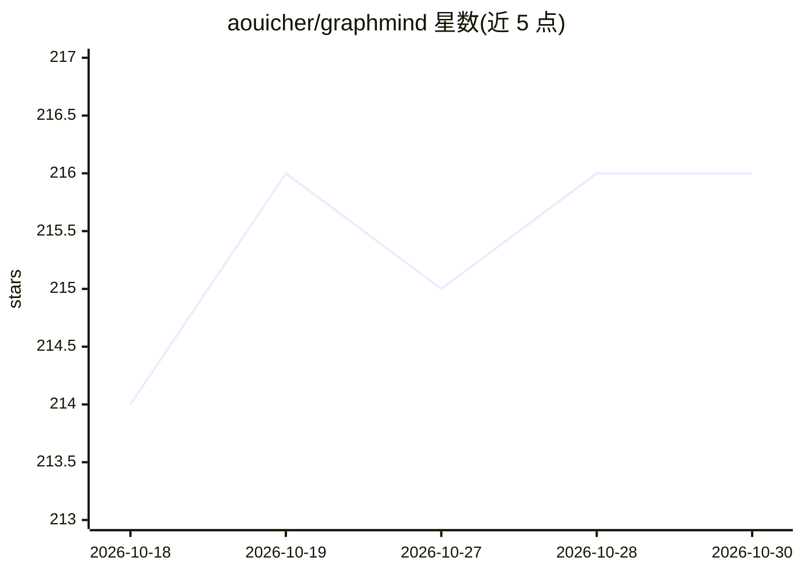

# aouicher/graphmind

⭐ 216 · Rust · MIT · 推送 2026-10-15 · [GitHub](https://github.com/aouicher/graphmind) · [官网](https://getgraphmind.com) · 个人维护

**把代码库转为知识图谱供 AI 助手查询的本地代码智能工具**

面向使用 AI 编程助手的开发者，将代码库构建为函数级知识图谱（tree-sitter AST 解析，支持 30+ 语言），叠加语义向量检索（本地 ONNX/OpenAI/Voyage AI）、跨会话持久记忆与跨项目依赖链接，通过 25 个 MCP 工具供 Claude Code、Cursor、Windsurf、Cline、Zed、Continue 等 MCP 兼容助手调用。全部本地运行，默认不开端口、无遥测。提供 macOS 桌面应用（.dmg）与多平台 CLI（安装脚本、Homebrew、二进制下载、源码编译），Windows/Linux 桌面版不可用（仅 CLI）。

## 筛选速览

| 维度 | 判定 | 备注 |
|---|---|---|
| AI 角色 | `ai-ecosystem` | LLM/agent 周边工具 |
| 许可风险 | `permissive` | MIT |
| 部署形态 | `desktop` | 安装包/桌面程序 |
| 模型依赖 | locked-api |  |
| 硬件要求 | — | 无带数字的原话,不猜 |
| 安装摩擦 | `low` | 无编译、无系统依赖或容器化 |
| 成熟度 | — | 结构信号不足 |

## 能力要点

- 函数级知识图谱 + 符号向量检索 + 持久记忆 + 跨项目链接四层结构
- 25 个 MCP 工具，适配 Claude Code/Cursor/Windsurf/Cline/Zed/Continue 等
- 本地运行，默认不开端口、无遥测、无云端依赖
- 提供 Claude Code hooks（搜索引导/会话上下文预取）与 /gm 技能（19 个子技能）

## 适用场景

- 让 AI 编程助手基于代码库真实结构回答死代码、依赖、影响范围问题
- 在多次 AI 会话间保留项目决策与约定，避免重复解释
- 在多个项目间追踪共享依赖与跨仓库关系

## 场景标签

`知识图谱` `语义搜索` · 领域:知识与检索

## 证据(README 行号)

> L8: GraphMind turns your codebase into a knowledge graph your AI can query, navigate, and remember. Ask about dead code,
> L10: Up to **5,700× fewer tokens** than raw search (~10M tokens saved per session). Works with Claude Code, Cursor, Wind
> L28: Everything runs locally. No cloud. No open ports by default. No telemetry.

## 星数曲线

2026-10-18 214 → 2026-10-30 216（+2）

---
*卡片 v1 · prompt 1.4 · 生成 2026-10-22 · 置信度 mid · 依据 README sha `3a058d9e16c2` · [字段定义](../../DATASET.md)*
